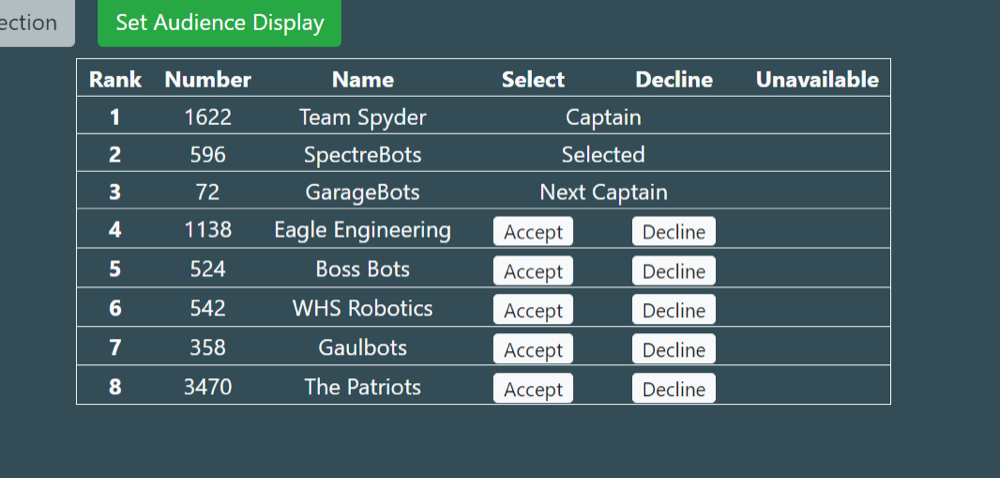
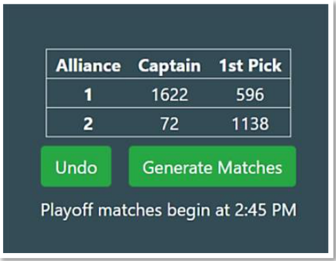
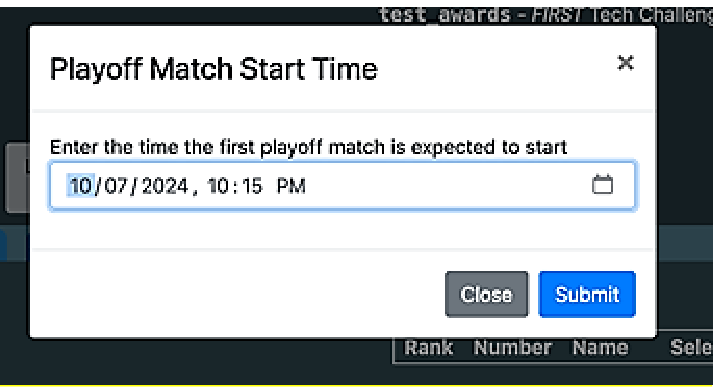
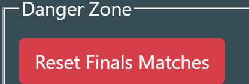

Alliance Selection and Playoffs
===============================

Alliance selection starts after the qualification matches are complete. The
details of alliances and selection rules are in the :term:`Competition Manual`,
Section 13.7.

Alliance Selection
------------------

Before you start, verify that all teams are ready for alliance selection.

.. important::

   The Scorekeeper must give the audience a view of alliance selection. Select
   **Set Audience Display** to switch the Audience Displays to Alliance
   Selection mode. You can also do this from the **Video Switch** tab of the
   Match Control page.

Start Alliance Selection
^^^^^^^^^^^^^^^^^^^^^^^^

#. Select the **Alliance Selection** tab on the Match Control page. The number
   of alliances adjusts automatically to the number of participating teams.
#. If a team is not competing in playoffs, select **Remove**.

   - The option appears after you select **Start Alliance Selection**.
   - Do this before selection starts.
   - Don't remove the team from the event team list.

#. Select the **Captain** button next to a team to make it an alliance
   captain. The team number then appears as the alliance captain, and the list
   of available teams updates.
#. When the captain makes their alliance's first invitation, select **Accept**
   or **Decline** for the invited team to show whether the team accepted or
   declined.
#. The Alliance Selection displays update as you select the buttons.
#. After the first alliance captain makes the first selection, the process
   begins again for the team that is eligible to captain the second alliance.

The software follows the alliance selection rules in the Competition Manual
when it works out and shows which of the remaining teams are eligible. If a
team isn't present, select **Remove** after you confirm with the Event Director
and Head Referee.

Repeat the selection process until all alliances are final.

Playoffs
--------

Playoffs begin after alliance selection ends. They need a schedule, which you
create with the **Generate Matches** button on the Alliance Selection page. The
awards breaks between playoff matches are built into the software as required.
The size of the playoff bracket depends on the number of teams competing at the
event.

The playoff rules, and an explanation of playoff alliance wins and losses, are
in the Competition Manual, Section 13.7.

Create the Playoff Schedule
^^^^^^^^^^^^^^^^^^^^^^^^^^^

When the alliances are final, select **Generate Matches** on the Alliance
Selection page to generate the playoff matches.

When prompted, enter the start time of playoff match 1 to initialize the
playoff matches.

After you enter the Playoff Match Start Time, leave Alliance Selection and go
back to the **Schedule** tab of Match Control to view and play the playoff
matches.

The Scorekeeper and Official Scorers run these matches the same way as the
qualification matches. See :doc:`/ftc_live/match_control/match-control`.

Print the Playoff Bracket and Schedule
^^^^^^^^^^^^^^^^^^^^^^^^^^^^^^^^^^^^^^

If field staff want it, print the playoff bracket after you enter the playoff
start time. At a minimum, give a copy to:

- The Event Director
- The Game Announcer or MC
- The Field Supervisor or FTA
- Pit Admin

You should also give each alliance captain a copy of the bracket.

Playoff Match Timing
^^^^^^^^^^^^^^^^^^^^

The timing of the playoff matches is based on these durations:

- Playoff cycle time: 6 minutes.
- Each match: 3 minutes.
- The required break under Competition Manual rule T406: 8 minutes.
- The awards break between matches: 15 minutes. There are three awards breaks
  in the playoffs, regardless of the event's size.

.. warning::

   Don't select **Show Match** until you are ready. The match start timer
   disappears from the displays.

Match start timers appear on all relevant audience and field displays.

Reset Alliance Selection or Finals Matches
------------------------------------------

At a single-division event, or when you manage a division at a dual-division
event, you may need to reset the alliances. This can happen if they must be
corrected after the playoff match schedule has been created. Select **Reset
Alliance Selection** in the **Settings** tab on the Match Control page. This
erases the alliance selection results, and you must enter alliance selection
again.

When you manage the parent event at a dual-division event, you may need to
correct the alliances that play in the inter-division finals after the matches
are generated. To clear the alliances chosen for the dual-division finals,
select **Reset Finals Matches**. At a dual-division finals event, this button
replaces **Reset Alliance Selection**, which isn't there.

For more on dual-division events, see
:doc:`/ftc_live/dual_division/dual-division`.
