Audience Displays
=================

This page shows the screens that FTC Live can put on the audience display
during an event. They are listed in the order they usually appear at an event.
Some are optional, depending on the size and capabilities of the event.

The Scorekeeper controls which screen appears from the Match Control page. See
:doc:`/ftc_live/match_control/match-control`. To show the audience display on
a livestream, see
:doc:`/event_streaming/addons/ftc_live_integration/ftc-live-integration`.

Non-Match Screens
-----------------

The non-match screens are usually shown at the beginning of the event or
during breaks. They are in the **Video Switch** tab of the Match Control page.

Sponsors
^^^^^^^^

Sponsors are vital to program support. Show the program sponsor and any local
sponsors that have donated to the program in your region or at your event.

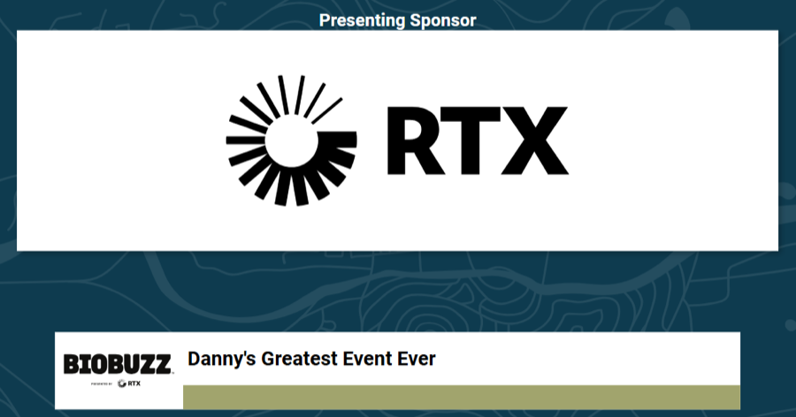

Safety and Security
^^^^^^^^^^^^^^^^^^^

Safety and security are an important part of a successful event. Show this
screen at the beginning of the event and after any break to tell people how to
report an issue.

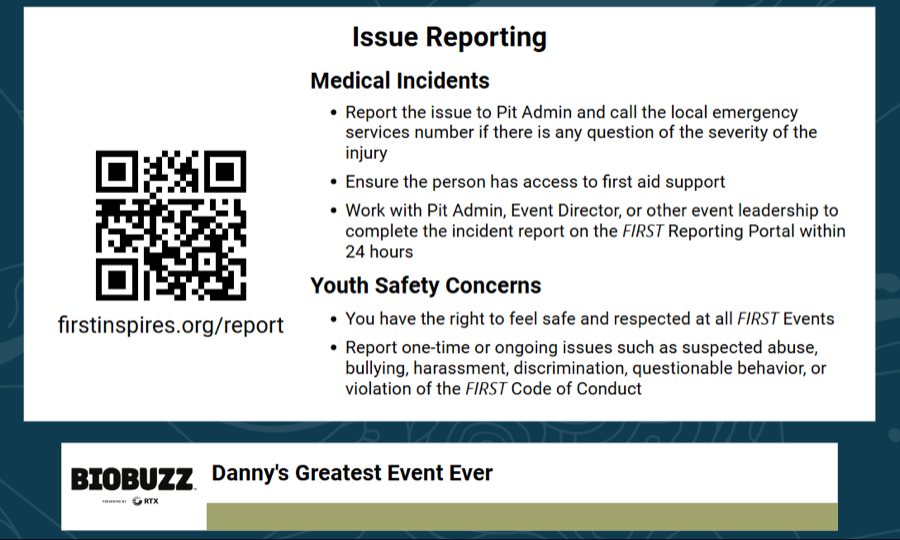

Wi-Fi Message
^^^^^^^^^^^^^

Every event must announce that people need to turn off Wi-Fi on phones,
tablets, and hotspots. Show this screen at the beginning of the event and at
the lunch break.

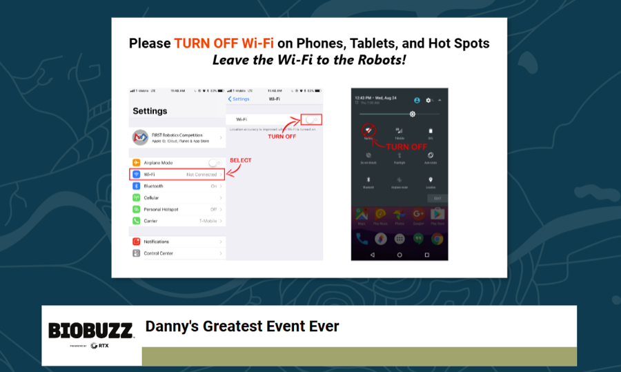

Online Results
^^^^^^^^^^^^^^

The audience may want to see the event results on the FTC Events website. Show
this screen at the beginning and the end of the event.

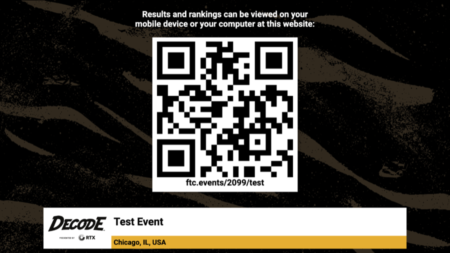

Audience Key
^^^^^^^^^^^^

The audience key screens teach the audience about the phases of the game, what
is scored in each phase, and how the scores for game elements are displayed.

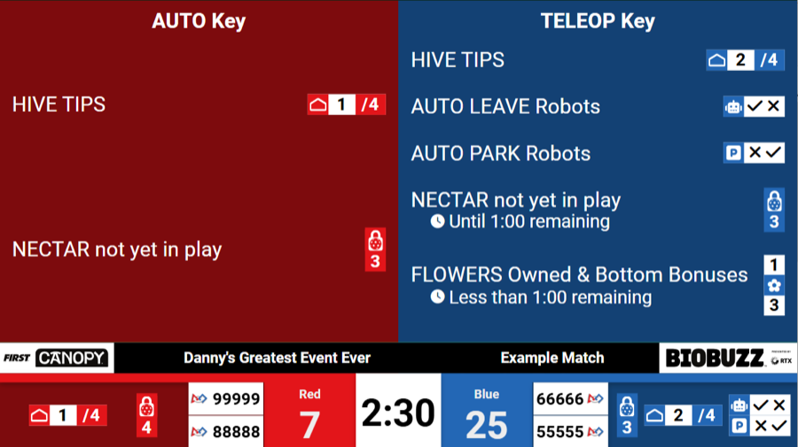

Message (Optional)
^^^^^^^^^^^^^^^^^^

The Event Director may ask for one or more messages during the event. Enter
the text on the Video Switch page when needed.

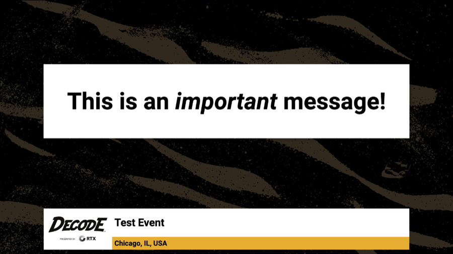

Inspection Status (Optional)
^^^^^^^^^^^^^^^^^^^^^^^^^^^^

If you have set up inspection tracking and the inspection schedule, you can
show this screen at the beginning of the event. See
:doc:`/ftc_live/inspection_tools/inspection-tools`.

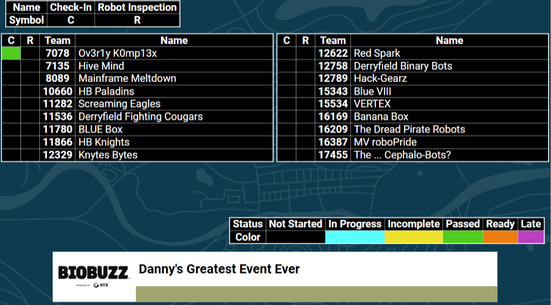

Blank (Optional)
^^^^^^^^^^^^^^^^

The blank screen shows only the event background and logo.

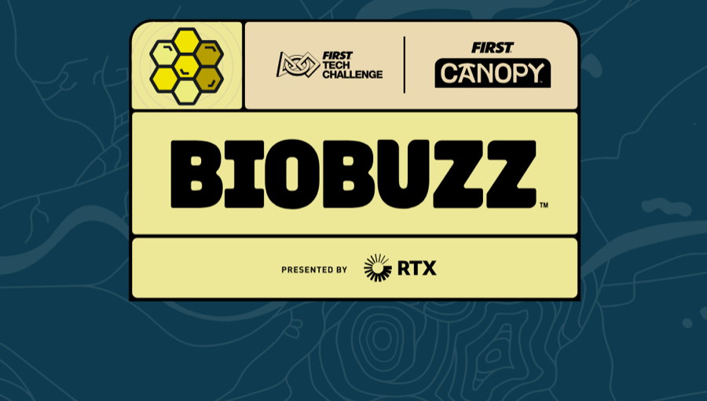

Event Match Screens
-------------------

The audience sees the live match, match results, alliance selection, and
advancement on the audience displays. The match screens change as the
Scorekeeper presses buttons on the Match Control page to move an active match
through its phases. Screens with "Overlay" in the title are for events that use
audio and video (AV) equipment.

Overlay Preview (Optional)
^^^^^^^^^^^^^^^^^^^^^^^^^^

This screen previews a match for an event that uses overlays.

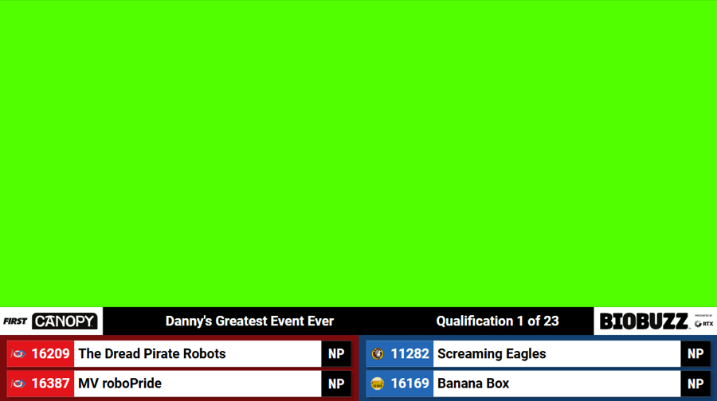

Match: Field Display
^^^^^^^^^^^^^^^^^^^^

During the AUTO period, the field display shows the match timer, the field
number, and each alliance's score.

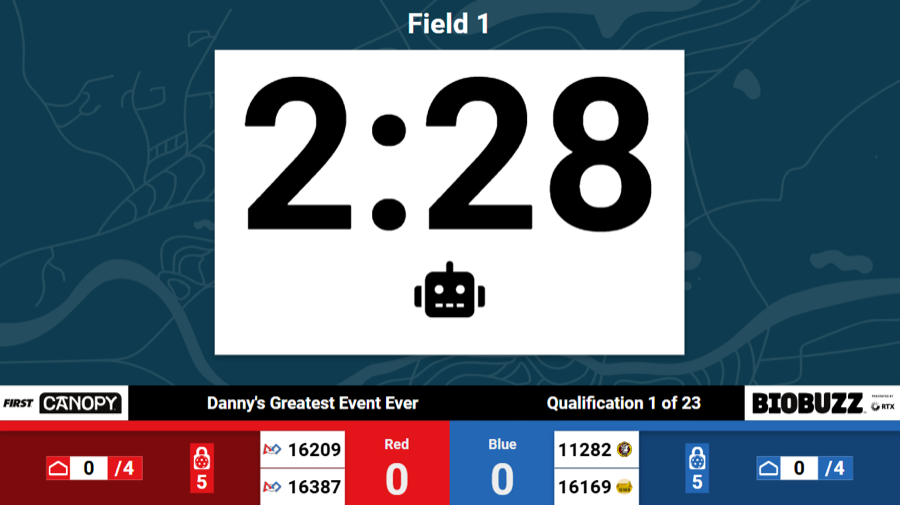

During the TELEOP period, the display shows the timer and the same scoring
information.

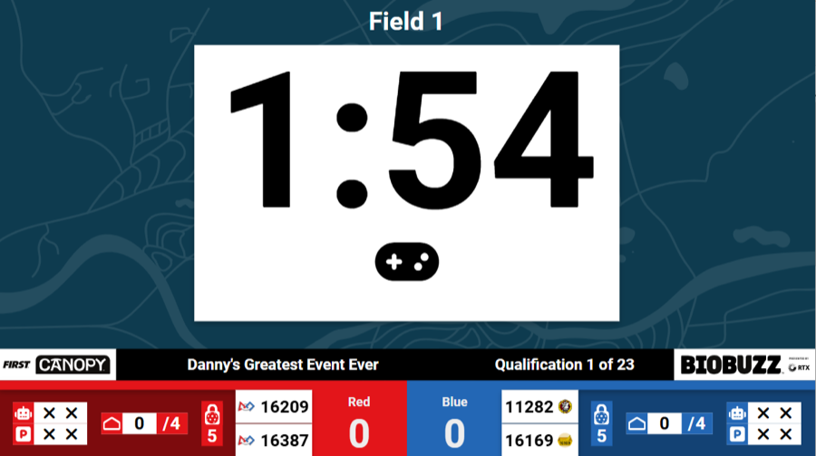

Overlay Match: Field Display
^^^^^^^^^^^^^^^^^^^^^^^^^^^^

The overlay field display shows a large, centered timer for every match
throughout the event.

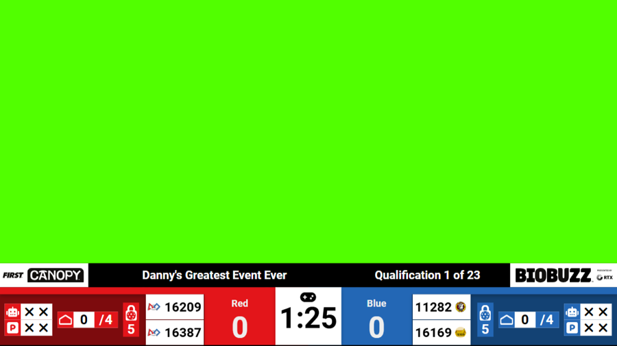

Match Results: Qualifications
^^^^^^^^^^^^^^^^^^^^^^^^^^^^^

The match results screen is one of the most important screens at an event. It
shows the match winner, the teams' rankings, the match scores, and the ranking
points earned. The QR code links to the FTC Events website.

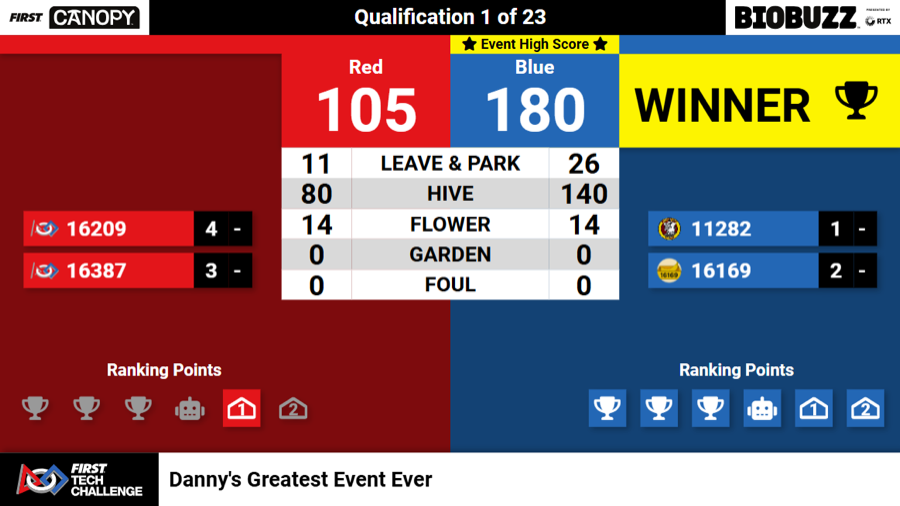

Timeout
^^^^^^^

The timeout screen appears between matches. The Competition Manual defines the
length of the timeout for qualification matches and for playoff matches.

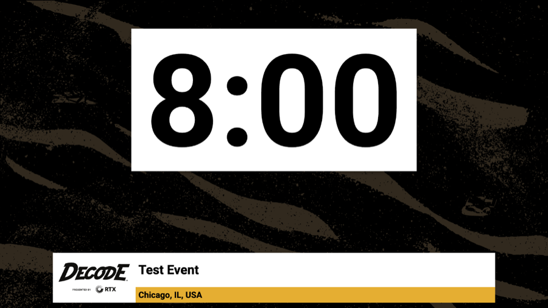

Rankings
^^^^^^^^

The rankings screen shows the current rankings as the event progresses through
the matches.

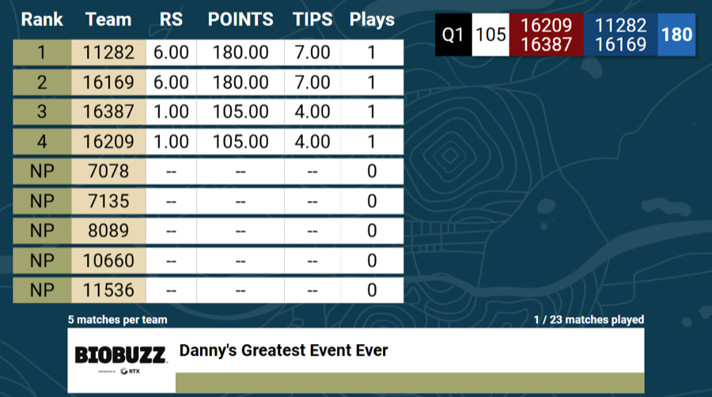

Alliance Selection Screens
--------------------------

Alliance Selection
^^^^^^^^^^^^^^^^^^

The alliance selection screen shows the audience what is happening during
alliance selection. Teams that appear crossed out can no longer be selected.
Alliance selection is complete when all the columns are filled. The next
screens are for the playoff matches.

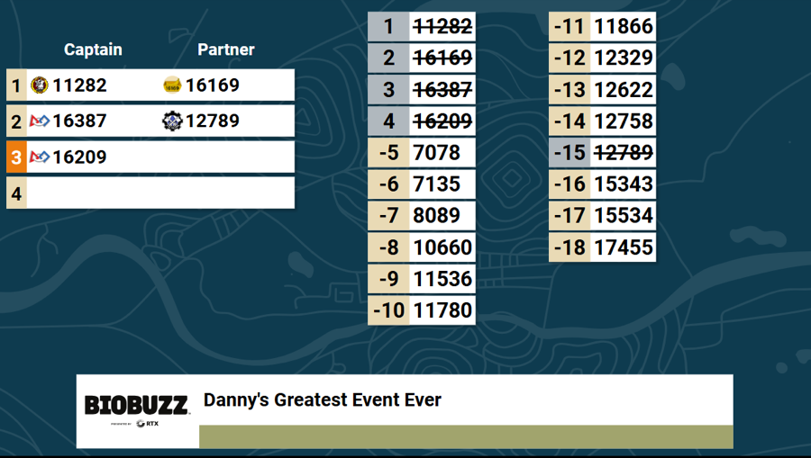

Hybrid Alliance Selection: Overlay
^^^^^^^^^^^^^^^^^^^^^^^^^^^^^^^^^^

The hybrid alliance selection screen is for events that use an AV overlay. As
on the standard screen, crossed-out teams can no longer be selected, and
alliance selection is complete when the columns are filled. The next screens
are for the playoff matches.

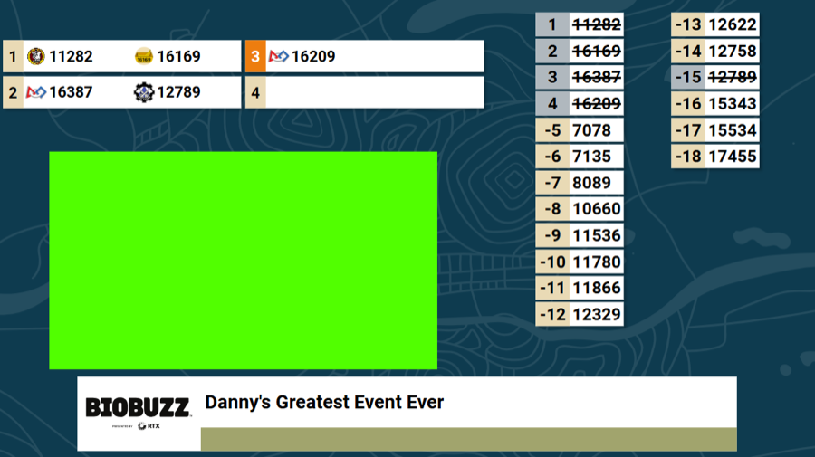

Playoff Screens
---------------

The playoff match screens pair with the playoff bracket screen, which shows the
alliances advancing through the playoff matches. Most of the playoff screens
include a QR code that links to the FTC Events website.

Playoff Preview
^^^^^^^^^^^^^^^

The playoff preview shows the upcoming match, the teams and alliances in it,
and how the alliances advance to the next match.

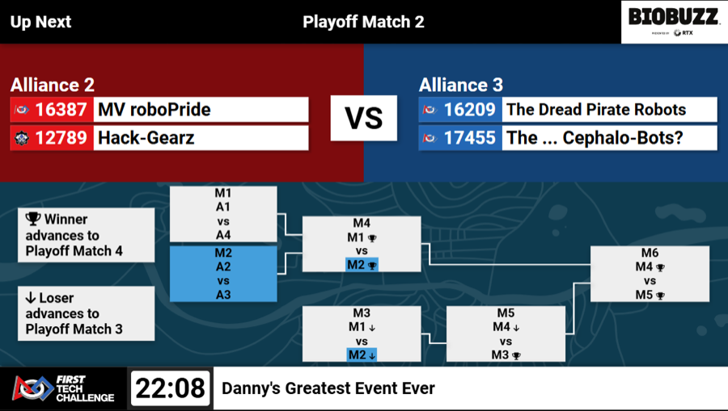

Empty Playoff Bracket
^^^^^^^^^^^^^^^^^^^^^

The playoff bracket screens show the audience how the alliances progress
through the playoffs. In the bracket:

- A match with a trophy shows the alliance that won the previous match.
- A match with a down-facing arrow shows the alliance that lost the previous
  match.

The empty bracket appears before the playoffs start, when no alliances are in
the matches yet.

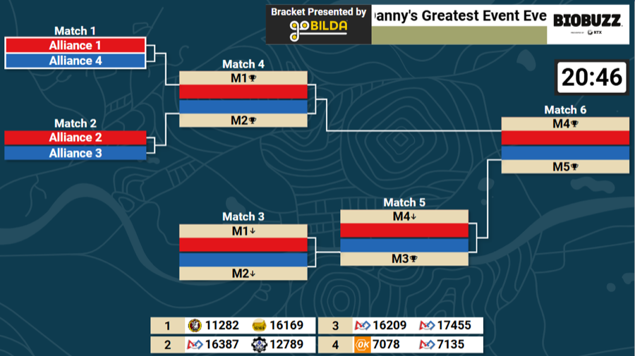

Playoff Partial Bracket
^^^^^^^^^^^^^^^^^^^^^^^

In the partial bracket, the alliances start to fill the matches. Trophy and
down-arrow markers work the same way as in the empty bracket.

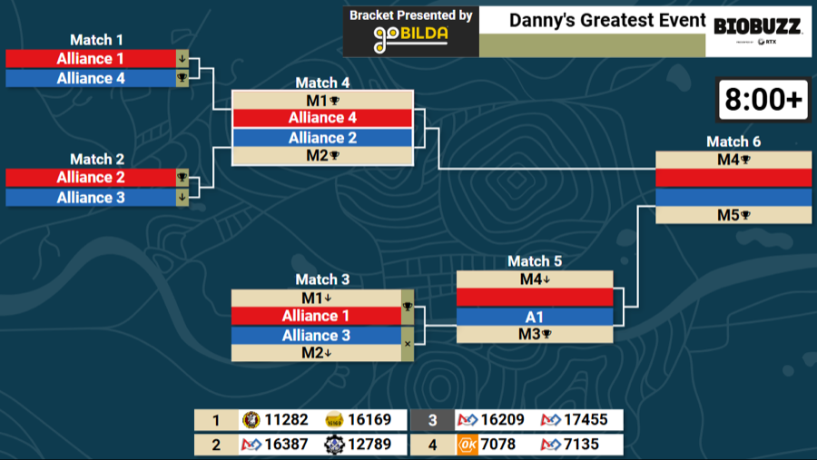

Playoff Full Bracket
^^^^^^^^^^^^^^^^^^^^

In the full bracket, the alliances fill every match. Trophy and down-arrow
markers work the same way as in the other brackets. A match with an alliance
marked with an X means that alliance does not progress past that match.

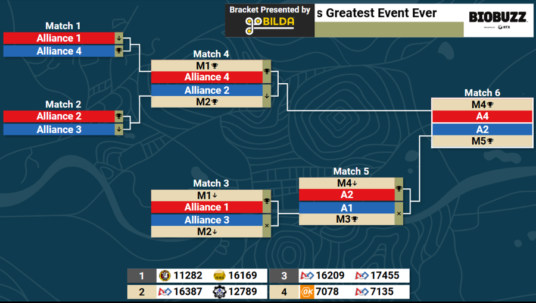

Match Results: Playoffs
^^^^^^^^^^^^^^^^^^^^^^^

This is another of the most important screens at an event. It shows the next
playoff match and the alliances that are advancing to it, the match winner,
the teams' rankings, the match scores, and the ranking points earned. The QR
code links to the FTC Events website.

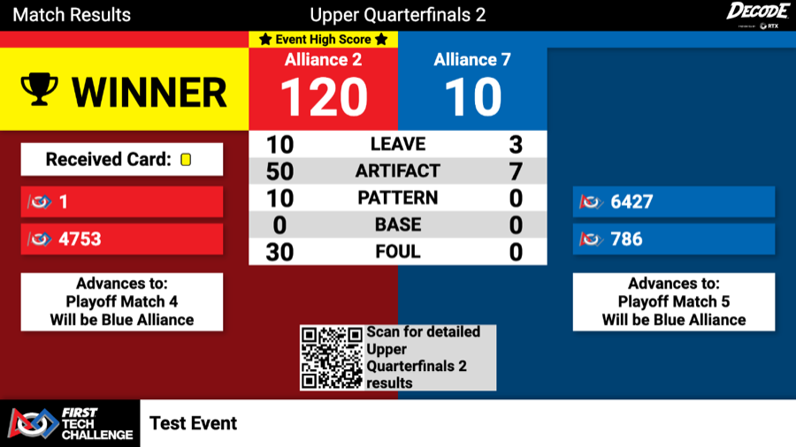

Match Results: Final Match
^^^^^^^^^^^^^^^^^^^^^^^^^^

The final match results screen shows the winner of the final match and the
match scores. The QR code links to the FTC Events website.

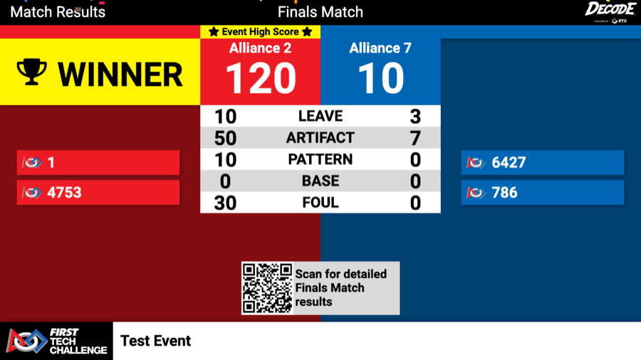

Awards
------

The awards screens celebrate the teams that won awards. The order in which to
show awards is on the Present Awards page. See
:doc:`/ftc_live/awards/awards`.

Awards Screen: Unfilled
^^^^^^^^^^^^^^^^^^^^^^^

The emcee uses the unfilled screen, which has no winner, to introduce the
award. When the winner is announced, show the filled version.

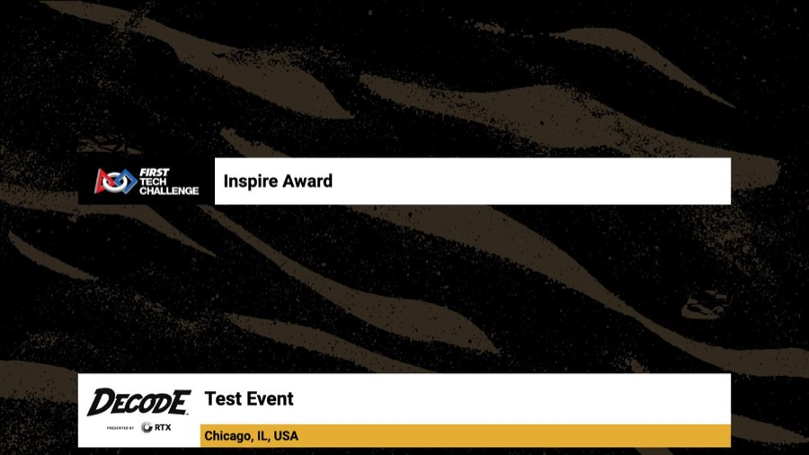

Awards Screen: Filled
^^^^^^^^^^^^^^^^^^^^^

After you enter or import the awards in FTC Live, the awards screen shows the
award name and the team's name, location, and number.

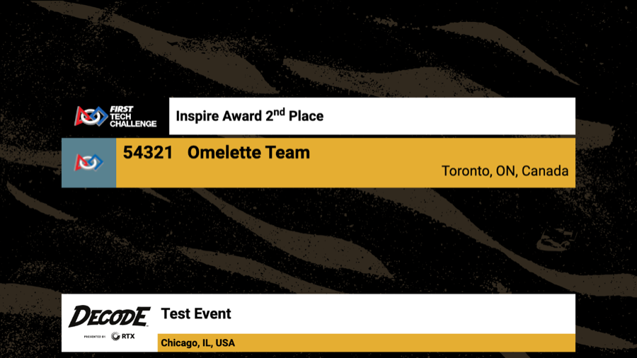

Awards Screen: Overlay Full Screen
^^^^^^^^^^^^^^^^^^^^^^^^^^^^^^^^^^

The overlay version of the awards screen is for events that use AV. It shows
the award and the winning team in a bar below a green video area.

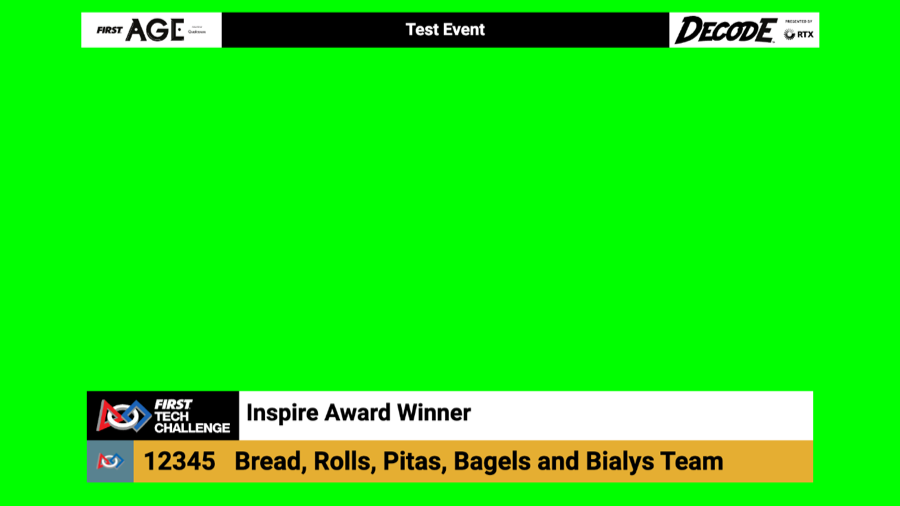

Advancement
-----------

The advancement screens are shown at the end of the event. They show the
number of teams advancing and the order in which they advance. Verify the
advancement order with the Event Director before you show this screen.

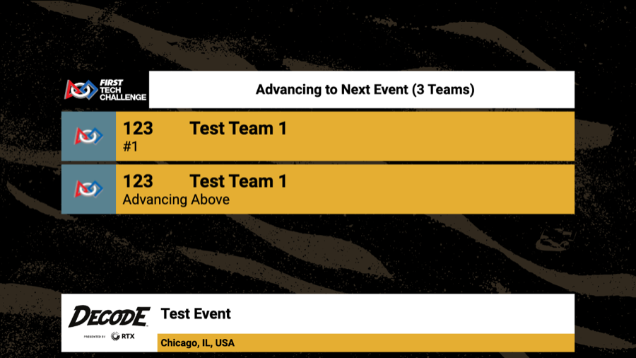

The overlay version is for events that use AV.

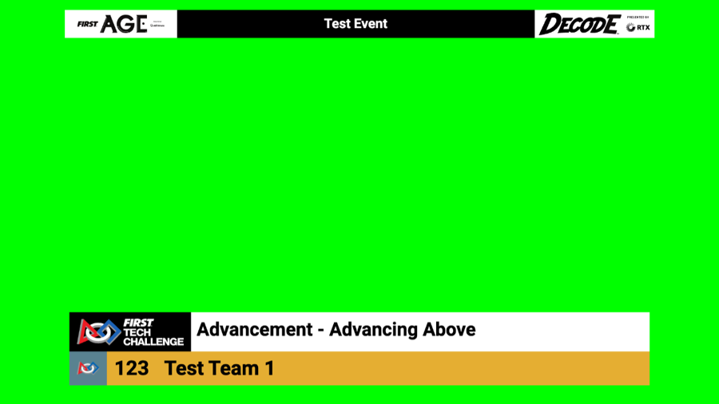

Slideshow
---------

The slideshow screen is available on the audience display.

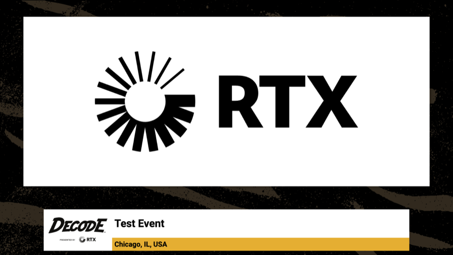

Video
-----

The video screen plays the event videos that *FIRST* provides. Videos show only
on the audience displays. Download the event videos before you use this screen.
See :doc:`/ftc_live/event_preparation/event-preparation`.

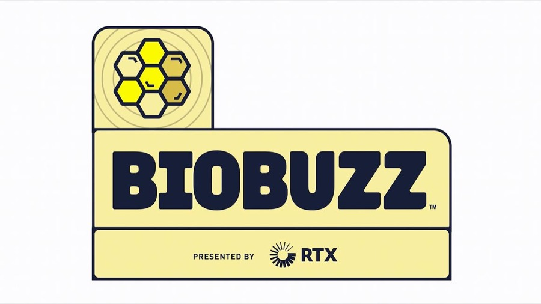
