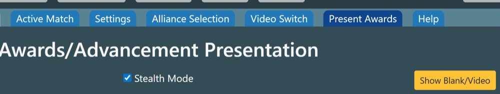
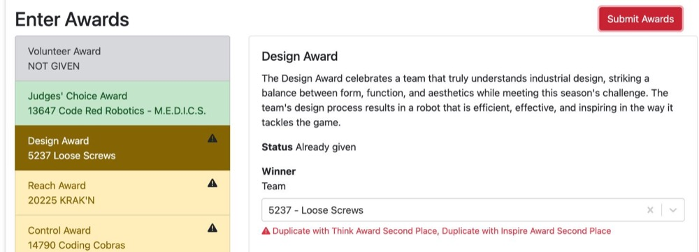
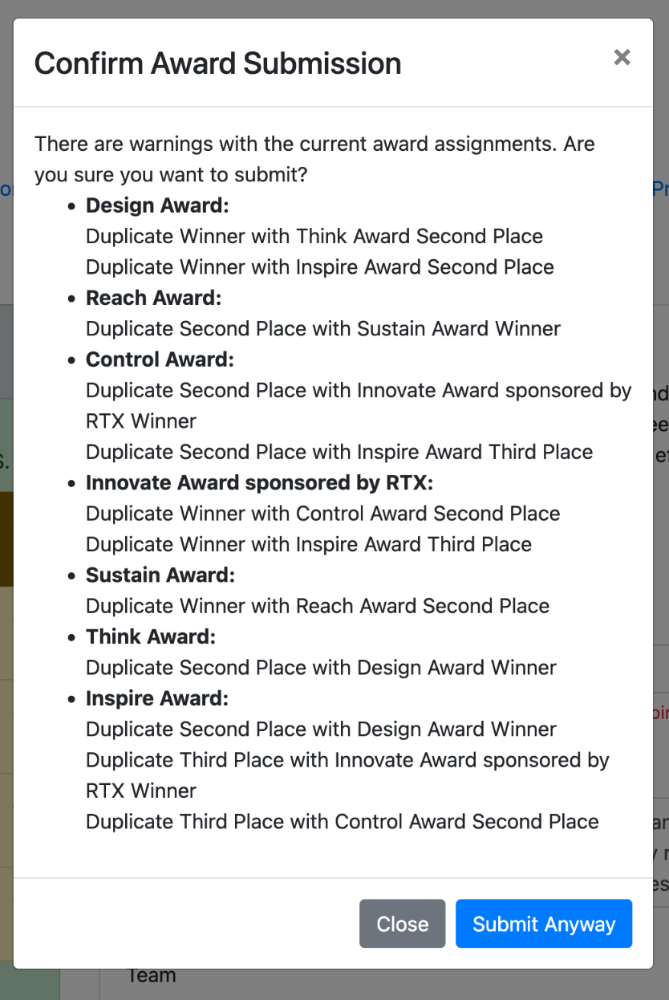

Managing Awards
===============

This page explains the Awards Manager, how awards data is handed off from the
Judge Advisor, how to present awards during the playoffs, and the warnings
FTC Live gives when awards are submitted.

Awards Manager
--------------

The Awards Manager is an integral tool for the official event results. You can
reach it from the event's home page in the Event Portal, or in FTC Live, where
the Scorekeeper works with the Judge Advisor. In the Event Portal, a Judge
Advisor uses it to enter the awards required for the event size (the number of
teams) plus any optional awards, and to edit the awards script. The same can be
done in FTC Live.

.. warning::

   Agree with the judges on who enters the awards and where. Awards have only
   one source of truth: either the Event Portal or the local FTC Live. If you
   enter awards in both places, one or more awards will be destroyed when they
   are uploaded or downloaded. See the Judge and Judge Advisor Guide for more
   information.

Who Enters Awards
-----------------

In most cases the Judge Advisor enters the awards, or sits with the
Scorekeeper while the Scorekeeper enters them. After the judges and Judge
Advisor decide the awards, they are entered in the FTC Live Awards Manager. For
each required award, it provides a drop-down list of the teams participating in
judging at the event. In both cases the Judge Advisor must confirm that the
correct teams are listed for each award. The Scorekeeper presents the awards.

How to Enter Awards
-------------------

The Awards Manager steps are in the "Manage Awards for Judge Advisors" section
of the Judge and Judge Advisor Guide.

Balance Awards Breaks in Match Flow
-----------------------------------

The Scorekeeper is responsible for the transition from matches to the award
presentation during the playoffs. The best practice is to use the **Present
Awards** tab on the Match Control page. The required awards breaks during the
playoff matches are explained in the :term:`Competition Manual`, Section 13.7.
For the playoff timing, see
:doc:`/ftc_live/event_operation/alliance_selection_and_playoffs/alliance-selection-and-playoffs`.

Present Awards
--------------

On the Match Control page, the **Present Awards** tab opens a page with the
awards grouped, so that only the awards required for each break are
presented. See :doc:`/ftc_live/event_operation/match_control/match-control` for the rest of the
Match Control page.

Award Submission Warnings
-------------------------

Enter awards before you submit the event ``.db`` file to *FIRST*. FTC Live
warns you if the awards aren't entered correctly:

- A team listed in more than one required award produces a duplicate warning.
  For example, a team entered as the Design Award winner and also as the Think
  Award second place shows "Duplicate with Think Award Second Place."
- A required award that is missing also produces a warning.

When you submit the awards, a confirmation window lists every duplicated or
missing award. Close the window to fix the awards, or choose **Submit Anyway**
if the warnings are expected.

