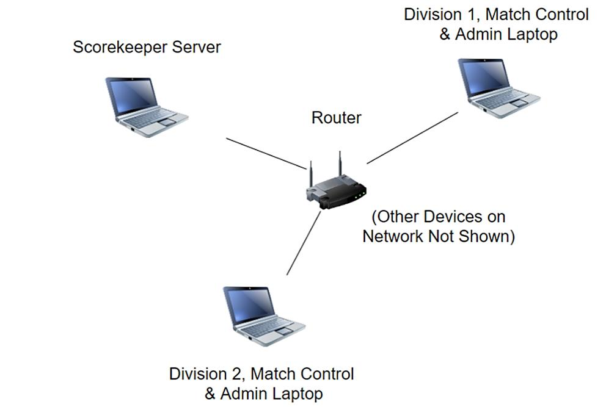
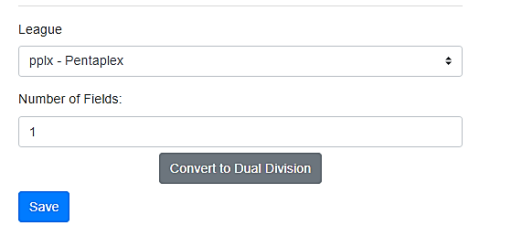
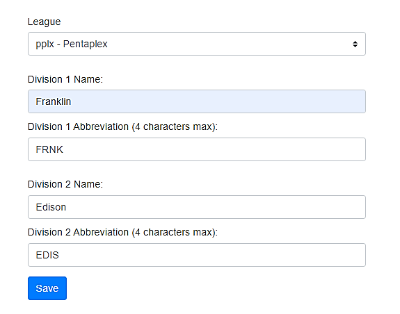
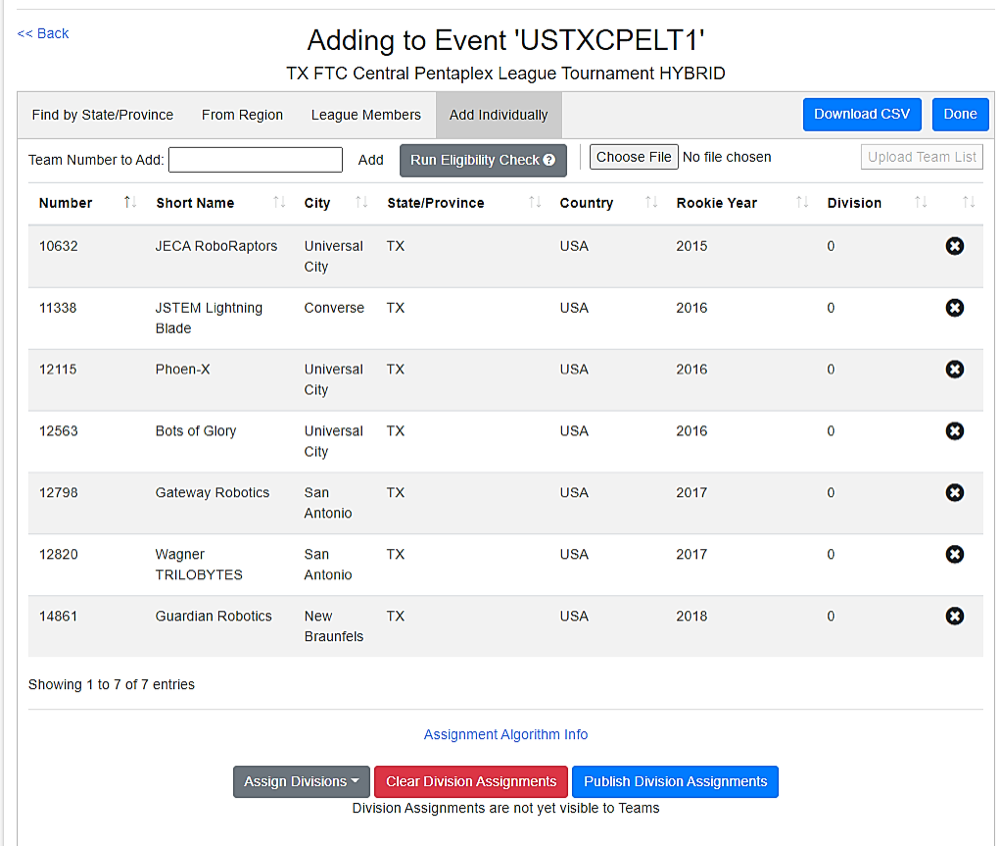
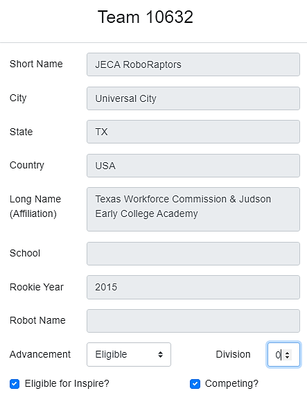
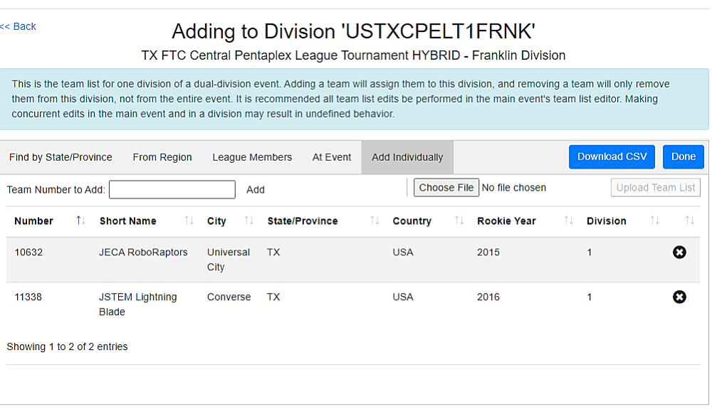
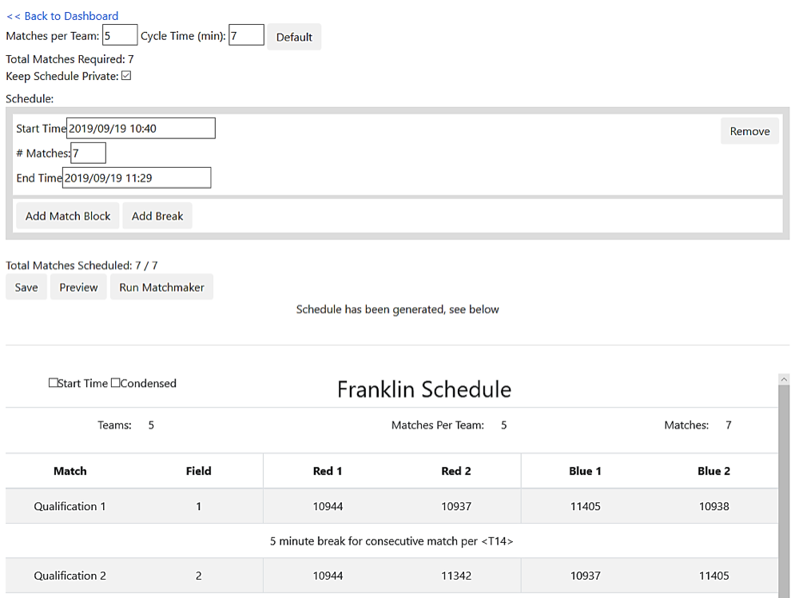
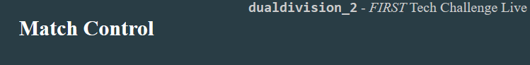
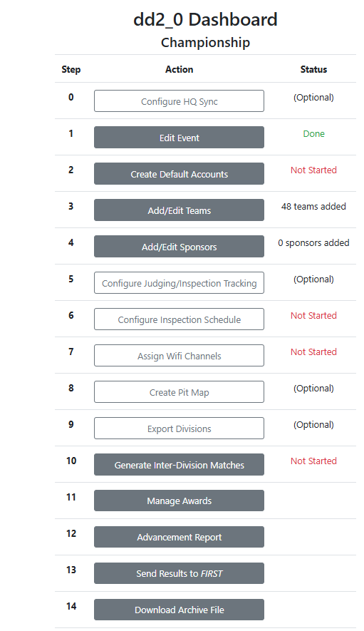
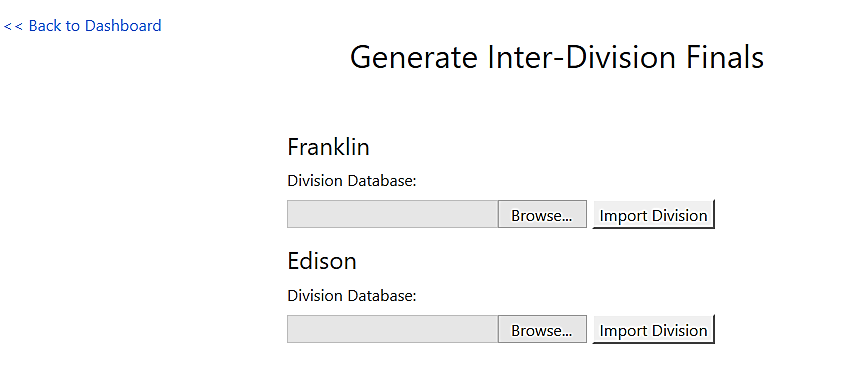

Dual Division Events
====================

A dual division event has two divisions that act as individual events. Each
is a parallel qualifying tournament with at least two fields. The divisions
play separately until the interdivision play that decides the event winner.
The :term:`Competition Manual` is the official explanation of a dual division
event. Review its rules, especially T801, T802, and T803.

Dual division events must be requested in the Event Portal using the Event
Request - Event Variant form. *FIRST* Headquarters staff review and approve
the request, which can take a few weeks. After the event is approved, the
Region Administrator must configure it in the Event Portal as a dual division
event, with division names, at least two weeks before the start date.

This page walks through setting up the divisions and merging the division
databases into the parent event for the interdivision matches. Read the pages
for the other FTC Live features you need to run an event as well.

Parent and Child Events
-----------------------

A dual division event is made of one parent event and two child events. The
parent event's URL ends with ``_0``. The child events end with ``_1`` and
``_2``.

Parent event (0)
   Generates the interdivision finals. You add all the teams in the whole
   event to it, and awards are given in it.

Child events (1 and 2)
   Each child event is one division. You add the teams in that division to it,
   and the division plays its matches there. No awards are given in a child
   event.

Data Flow
^^^^^^^^^

The child events hold all the data for division play. After both divisions
finish their play, import that data into the parent event (``_0``). The
interdivision finals are then generated in the parent event, and all the
audience displays redirect to the parent event.

Hardware and System Requirements
^^^^^^^^^^^^^^^^^^^^^^^^^^^^^^^^

- One scorekeeper server runs the parent event (``_0``) and both divisions.
- All devices are on the same private network.
- Each event (``_0``, ``_1``, and ``_2``) needs a laptop for its Match
  Control and admin page.
- Each event also needs its own display laptops and monitors.
- Each event needs tablets for live scoring.

.. note::

   If you need to run a separate server for each division, contact FTC
   technical support before the event to make sure it is supported.

Set Up the Divisions in the Event Portal
----------------------------------------

The Region Administrator logs in to the Event Portal to configure the event at
least two weeks before it starts.

Convert to Dual Division
^^^^^^^^^^^^^^^^^^^^^^^^

On the event's settings page, select **Convert to Dual Division**.

.. important::

   The **Convert to Dual Division** button only appears for regions that have
   an HQ-approved dual division event.

Configure the Divisions
^^^^^^^^^^^^^^^^^^^^^^^

Give each division a name and an abbreviation. These determine the divisions
as child events. Each abbreviation must be four characters or fewer.

Add Teams to the Events
^^^^^^^^^^^^^^^^^^^^^^^

Add the participating teams to the parent event in the Event Portal. Go to the
event dashboard to do this. Then add teams to each division with the **Assign
Divisions** button at the lower left of the page.

To change the division a team is in, select the parent event's **Add/Edit**
button, then **Add Individually**, and edit the **Division** field.

Edit Teams
^^^^^^^^^^

You may need to move a team from one division to another because of team
conflicts, a conflict of interest, or another competition requirement. The
best practice is to edit team profiles on the **Add Individually** tab of the
parent event's **Add/Edit Teams** page.

.. important::

   In the Event Portal, assigning a team to a division adds the team to both
   the parent event and the division. Removing a team from a division does
   *not* remove it from the parent event. Remove the team from the parent event
   as well.

Transfer the Event to FTC Live
------------------------------

Each division appears on the parent event's home page in the Event Portal. To
transfer the event data:

#. Go back to the parent event dashboard.
#. Select **Play Event Locally** to transfer the event to FTC Live.

For the timing and the transfer methods, see
:doc:`/ftc_live/setup/transfer_event_data/transfer-event-data`.

Generate Matches for Each Division
----------------------------------

Generate the qualification matches for each division on that division's event
laptop.

#. In FTC Live, select the **Divisions** drop-down and choose the correct
   division for the laptop. Use one division per laptop.
#. The division's dashboard opens, titled ``_1 Dashboard`` or
   ``_2 Dashboard``.
#. Complete the steps before creating the match schedule that your event
   needs. Consult the Event Director and FTA if needed.
#. Select **Create Match Schedule**. Do this on each division's laptop.
#. Select **Run Matchmaker** to create the division's schedule.

For more about creating the schedule, see
:doc:`/ftc_live/event_operation/match_control/match-control`.

.. warning::

   Make sure the correct teams are assigned to the division before you
   generate its matches.

Each division has its own Match Control page. You can tell which one you are
on by the ``_0``, ``_1``, or ``_2`` in the upper right corner. Score each
division in its own Match Control page. Both divisions must finish their play
before the interdivision finals can happen.

Generate the Interdivision Final
--------------------------------

The **Generate Interdivision Final** button is on the parent event's Event
Dashboard. Before you use it, commit the last playoff matches for all
divisions.

.. note::

   The **Generate Inter-Division Finals** button doesn't work until all the
   remaining playoff matches are committed.

One Server for Both Divisions
^^^^^^^^^^^^^^^^^^^^^^^^^^^^^

If the whole event uses one scoring server, you don't need to export and import
the divisions, because the files are already on the scoring server laptop. On
the parent laptop, open the **Generate Inter-Division Finals** page. When both
divisions appear, select the **Generate Inter-Division Finals** button at the
bottom.

Separate Servers for Each Division
^^^^^^^^^^^^^^^^^^^^^^^^^^^^^^^^^^

.. warning::

   Using a separate server for each division must be approved by FIRST
   Technical Support before the event.

If each division used its own server, export each division's database file
from its laptop with the wizard described in
:doc:`/ftc_live/event_operation/after_the_event/after-the-event`. Then, on the parent laptop:

#. Copy the files to the parent laptop, for example with a USB drive.
#. On the **Generate Inter-Division Finals** page, select **Browse** and choose
   the file for each division.
#. Select **Import Division** for each division.
#. When both divisions appear, select the **Generate Inter-Division Finals**
   button at the bottom.

Awards for Dual Division
------------------------

Awards for a dual division event are entered and presented in the parent
event. See the :term:`Competition Manual` and
:doc:`/ftc_live/event_operation/awards/awards` for the process of entering and presenting
awards.
