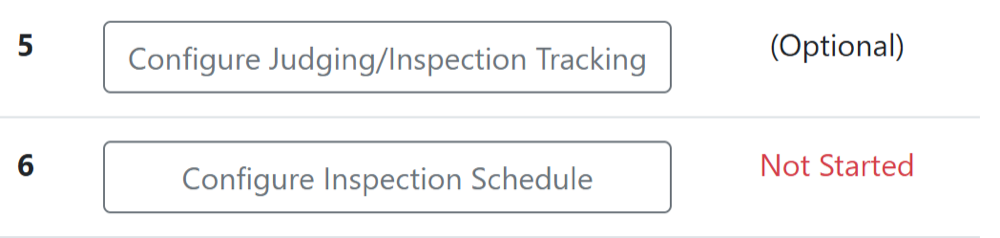
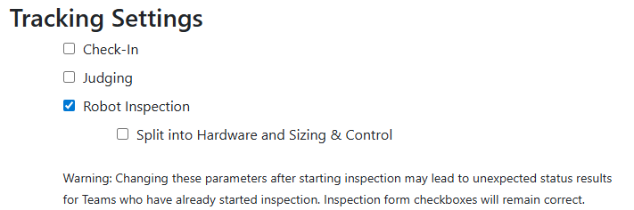
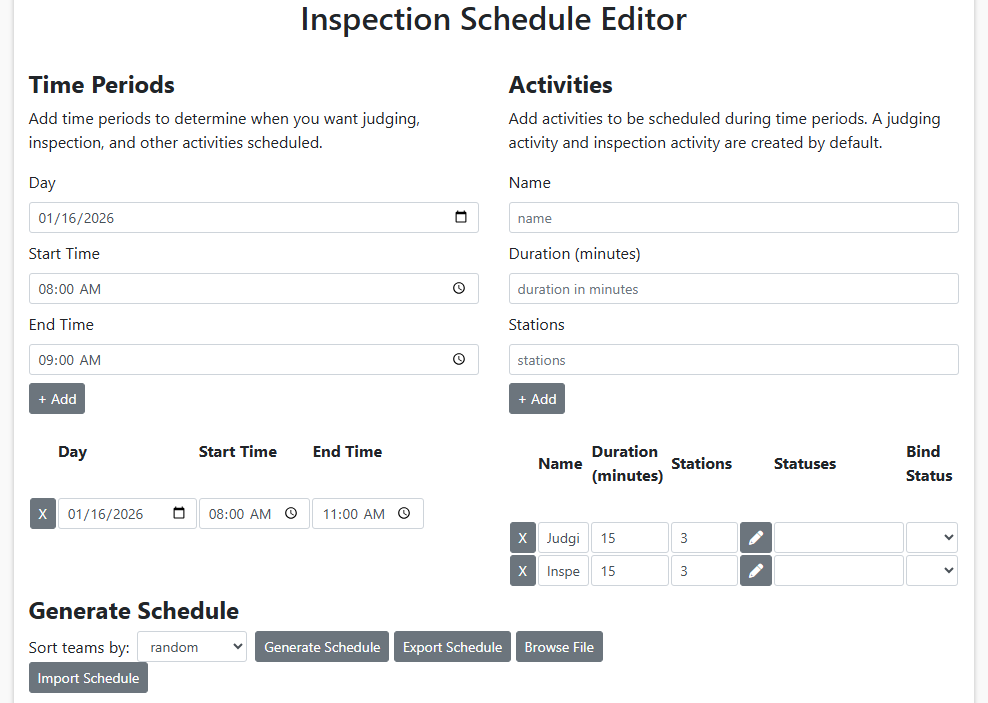
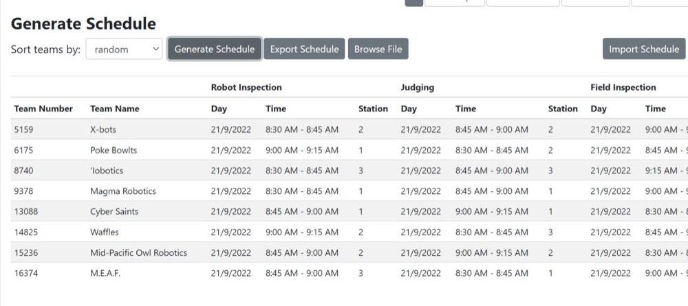

Inspection Tools
================

The Event Dashboard has an optional inspection schedule and optional
inspection tracking. They are the **Configure Judging/Inspection Tracking**
and **Configure Inspection Schedule** steps.

Configure Inspection Tracking
-----------------------------

On the **Tracking Settings** page, check the boxes for the items that a tablet
will handle.

.. warning::

   Changing these settings after inspection has started can give unexpected
   status results for teams that have already started inspection. The
   inspection form check boxes stay correct.

Configure Inspection Schedule
-----------------------------

Select **Configure Inspection Schedule** on the Event Dashboard to open the
Inspection Editor page. It covers the judging, robot, and field inspections.

Generating the schedule gives you a list of teams with a day and time for each
team added to the event. The system sets default times and stations, and you
can edit them.

Time Periods
^^^^^^^^^^^^

Time periods break the day into the blocks in which you want judging,
inspection, and other activities scheduled.

Activities
^^^^^^^^^^

Use the **Activities** fields on the right side to add event activities to the
schedule. A judging activity and an inspection activity are created by
default. For each activity:

- Choose a **Duration**, the number of minutes for each session.
- Decide how many **Stations** the number of teams at the event needs.
- **Statuses** show where a team is in the queue.
- Select **Bind Status** if you want the system to flag when a team is late for
  a specific type of inspection, such as judging.

Generate the Schedule
---------------------

The generated schedule includes the details from the fields you filled in.

- Select **Generate Schedule** to create it.
- Sort the teams with the **Sort teams by** drop-down.
- Select **Export Schedule** to export it.
- Select **Import Schedule** to import a schedule that you already created.

.. warning::

   Do not use FTC Live to schedule judging for hybrid events. The Judge Advisor
   or Region Administrator schedules hybrid event judging in the cloud-based
   Event Portal.
