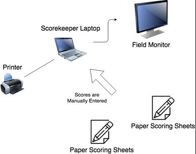

Paper Scoring
=============

Paper scoring is an emergency backup for an unexpected failure of the event
scoring network. Paper scoresheets replace the scoring tablets, so teams can't
see real-time scoring information.

The most basic configuration needs one laptop that is both the Scorekeeper
computer and the field display computer. It also has an external monitor as
the field-side display, and a printer for match schedules. The Scorekeeper
enters the scores from the paper scoresheets by hand.

   Paper scoresheets require a scoring server laptop to manually enter the
   scores.

.. important::

   Don't transfer and set up the event until the data from all earlier events
   has been uploaded. Uploaded data ensures accurate configuration, team
   advancement, and award eligibility data.

   Wait to transfer the event data in FTC Live until 24 to 48 hours before the
   event, or until all earlier events are uploaded and you have verified the
   event configuration in the Event Portal. See
   :doc:`/ftc_live/setup/transfer_event_data/transfer-event-data`.
