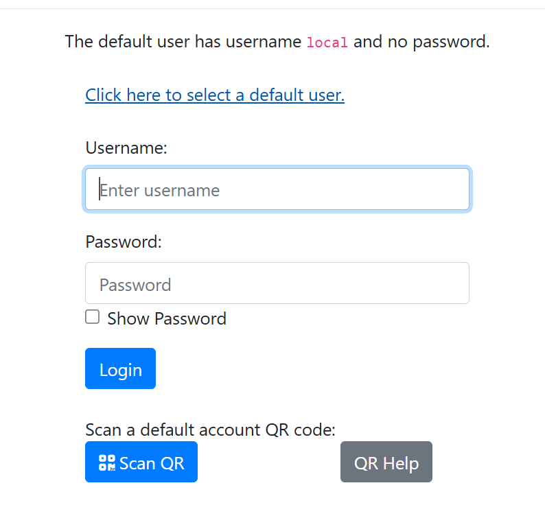
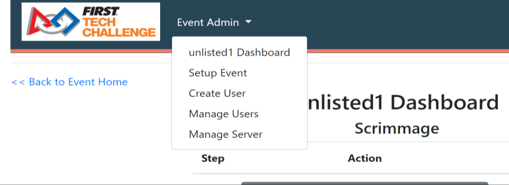

Install FTC Live and Log In
===========================

This page covers downloading and installing FTC Live on the scoring server,
finding its version number and IP address, and logging in.

Download the Software
---------------------

The FTC Live installer is in the Event Portal, on the *Resources* tab, as
"Scoring System Download." You only need to download and install it once per
computer per season. When you launch FTC Live with an internet connection, it
downloads any available updates automatically.

Before you download:

- Read the release notes.
- Software for 2023 and newer seasons is available from the Event Portal.
  Software for the 2019-2022 seasons is available from GitHub releases.
- The scoring system is an installer, not a ZIP file to unpack. A ZIP file is
  still available for computer architectures that the installers don't
  support.
- FTC Live stores databases in ``Documents/FIRST Tech Challenge Live/<season>``.

The Event Portal detects your platform and offers a download button for it. To
download for a different system, such as when you download on a Mac to put the
installer on a flash drive for a Windows scoring server, select **All
platforms**.

.. note::

   You can't run two versions of FTC Live on the same laptop. If FTC Live is
   already installed, close all FTC Live windows and restart the app to get
   the latest updates.

Install on Windows
^^^^^^^^^^^^^^^^^^

#. Launch the downloaded ``.exe`` installer if your browser doesn't launch it
   for you.
#. In the setup wizard, select **Next**, and choose an installation folder that
   is easy to find.

   .. image:: images/installer-welcome.png
      :alt: The FTC Live setup wizard welcome screen with Next and Cancel buttons.

#. On the Ready to Install screen, review the destination and select
   **Install**.

   .. image:: images/installer-ready.png
      :alt: The Ready to Install screen listing the destination folder and a desktop shortcut, with Back, Install, and Cancel buttons.

#. When the install finishes, check the box to launch the software, then
   select **Finish**.

After the server starts, your default web browser opens the main page at
``localhost``. The default browser should be Google Chrome.

Install on macOS
^^^^^^^^^^^^^^^^

#. Download and open the DMG file.
#. Drag the application into the **Applications** folder.
#. Open the **Applications** folder and open the FTC Live application.

After the server starts, your default web browser opens the main page at
``localhost``.

Before You Run FTC Live
-----------------------

- Install Google Chrome and make it the default browser. Firefox isn't
  supported.
- Disable any firewall or virus protection on the computer running the server.
- Disable ad-blocking software on devices that connect to the server. Ad
  blockers sometimes mistake server resources for ads.
- Clear the browser cache.

Get the Version Number and IP Address
-------------------------------------

Open FTC Live. The splash screen shows the software version number and the IP
address of the scoring server. Knowing the version helps because the software
updates between releases.

.. caution::

   The IP address on the splash screen is a best guess. If the computer has
   more than one network adapter, the address shown may not be the right one
   for tablets to use to reach the scoring server. Check it before you give it
   to anyone.

Log In
------

When FTC Live opens, it launches a web browser and goes to the login page. If it
doesn't, select **Open in Browser** on the splash screen. You can also open a
browser and enter ``localhost`` in the address bar, which almost always reaches
FTC Live while it is running.

The default login is the username ``local`` with no password. It gives you the
Event Admin role, the primary administrative role, with access to every
feature of FTC Live. The volunteer running FTC Live on the scoring server
laptop uses this role.

The Event Admin Menu
--------------------

The **Event Admin** menu is at the top left of every page.

Setup Event
   Creates a single event from an event key found on the *Play Event Locally*
   page in the Event Portal, or creates an unlisted event. See
   :doc:`/ftc_live/transfer_event_data/transfer-event-data`.

Create User
   Creates individual user accounts for people who need only some FTC Live
   features.

Manage Users
   Manages the event's users and their access to the system.

Manage Server
   Manages the server for an event.
