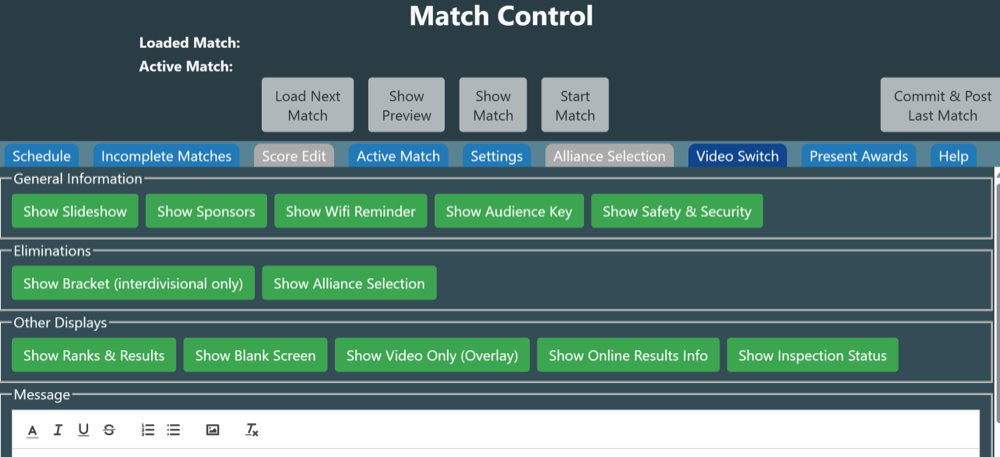
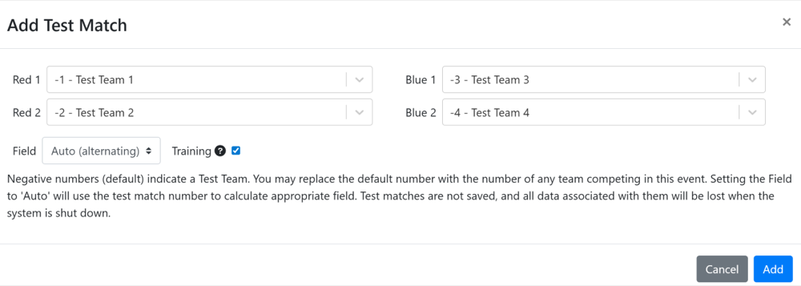
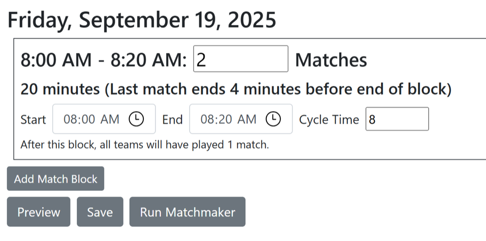
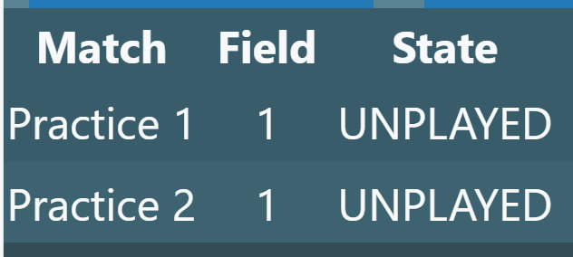
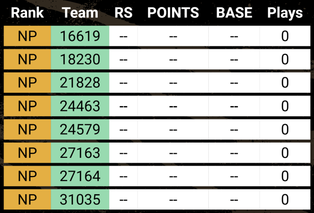

Match Control
=============

The Match Control page opens the scoring and display options of FTC Live. The
Scorekeeper spends most of the event on this page. It is where the match timer
is controlled and scores are edited. Open it from the event home page.

To follow along with this page before the event, open Match Control in an
unlisted event. See
:doc:`/ftc_live/transfer_event_data/transfer-event-data`.

Contents of the Match Control Page
----------------------------------

Schedule
   Lists the test, qualification, or playoff matches. Use it to keep track of
   matches, commits, and posts.

Incomplete Matches
   Shows matches that have not been committed or posted. Reconcile these
   before you go on to the next match.

Score Edit
   Edits a posted score.

Active Match
   Shows the match that is being played.

Settings
   Has most of the tools you use in the system. Discuss these settings with the
   Head Referee and the FTA or Event Director, and set them before the event
   starts:

   - **Enable Recorded Countdown** plays a recorded countdown and starts the
     match automatically. Use it for events without an emcee.
   - **Use Live Scoring** is checked by default.
   - **Require Official Scorer Init Submit Before Start?**
   - **Enable HR Match Control?**
   - **Allow External Randomization**, only for seasons that include
     randomization.

Alliance Selection
   Runs alliance selection after the qualification matches are complete and
   before playoffs. Use it with a display. See
   :doc:`/ftc_live/alliance_selection_and_playoffs/alliance-selection-and-playoffs`.

Video Switch
   Has all the options for what the displays show. Go to this page to change
   the information a display shows. It includes:

   - **Videos** plays *FIRST*-provided videos on Audience Displays. It can't
     play your own videos.
   - **Connected Displays** tracks and configures the connected displays.

   See :doc:`/ftc_live/audience_displays/audience-displays`.

Present Awards
   Shows the awards on displays after they are entered in the Awards Manager.
   See :doc:`/ftc_live/awards/awards`.

Help
   Has the FTC Live Tech Support chat button, support phone numbers, and a link
   to the GitHub Scorekeeper repository, where you can file bugs or
   improvements. The same links are under **Resources** in the upper right of
   the home page.

.. tip::

   Use the Match Control page in full screen mode, and don't navigate away from
   its browser tab. To have two or more pages open on the same laptop, such as
   Match Control and the field display, launch a separate browser window for
   each.

Test Matches
------------

Test matches are different from practice matches. Use them to train volunteers
and to test the FTC Live system before you run practice or qualification
matches. You can use them to train as an Official Scorer (check the
**Training** box) or to try new features with the default test teams.

Test matches are found in the **Settings** tab of the Match Control page.

What to Test
^^^^^^^^^^^^

Test the whole system, including the displays and Official Scorer tablets.
Play test matches on the Match Control page after the system is set up and
volunteers have their accounts and are logged in on the tablets. Check that:

- The tablets work correctly:

  - Each alliance's Official Scorer tablet stays connected for the entire
    match.
  - Official Scorers can submit autonomous, teleop, and final scores.

- The displays update through the phases of the match, including Start Match
  and randomization.
- The right display types are on the right display laptops.
- **Post** and **Commit** push the winning animation to the displays.

How to Exit Test Matches
^^^^^^^^^^^^^^^^^^^^^^^^

Go back to the **Settings** tab and select **Exit Test**.

Practice Matches
----------------

Practice matches happen on event day, on the schedule planned before the
event. Teams use them to practice before the qualification matches. For the
rules for these matches, see the :term:`Competition Manual`. Give each team an
equal number of matches if possible.

If your event has no planned practice matches, go on to
:ref:`ftc live qualification matches`.

Create the Practice Match Schedule
^^^^^^^^^^^^^^^^^^^^^^^^^^^^^^^^^^

The practice matches have their own schedule. Create it on the FTC Live Event
Dashboard before the matches can appear on the Match Control page. On the event
home page, go to the Event Dashboard and select **Practice Match** to open the
Practice Match Schedule.

#. Adjust the **Start**, **End**, and **Cycle Time** for the matches.
#. Make sure the number of teams includes every team that wants to take part.
#. Select **Preview** or **Save** before you select **Run Matchmaker**.
#. Activate the matches, then go to the Match Control page to play them.

.. note::

   Publish the schedule before the practice matches start.

Navigate to Practice Matches
^^^^^^^^^^^^^^^^^^^^^^^^^^^^

After you activate the schedule, the matches appear in the **Schedule** tab on
the Match Control page as "Practice 1," "Practice 2," and so on.

How to Exit Practice Matches
^^^^^^^^^^^^^^^^^^^^^^^^^^^^

Go to the **Settings** tab in Match Control and select **Advance to Quals**.
To bring the practice matches back on the schedule, select **Return to
Practice**.

.. _ftc live qualification matches:

Qualification Matches
---------------------

All official event types have qualification matches. Schedule them after the
team list is final, meaning all teams have checked in. Use **Create Match
Schedule** on the Event Dashboard to create qualification matches only.

Before You Create the Qualification Schedule
^^^^^^^^^^^^^^^^^^^^^^^^^^^^^^^^^^^^^^^^^^^^

Verify these items:

- The start time of the matches and of the whole event.
- The end time of the event, and so of the matches.
- The planned cycle time for matches, which is how long each match takes to
  run and reset.
- Whether there is a lunch break. Use **Add Blocks** to split the day into
  match blocks.
- The participating teams. Review them one last time with the Event Director
  and the FTA.
- Whether any team is present that isn't marked as "Judging Only."
- Whether all teams are competing. If not, change the team's competing status.
  See :doc:`/ftc_live/event_preparation/event-preparation`.

Create the Qualification Match Schedule
^^^^^^^^^^^^^^^^^^^^^^^^^^^^^^^^^^^^^^^

The schedule you make with **Create Match Schedule** on the Event Dashboard
fills in the matches on the Match Control page.

#. Adjust the **Start**, **End**, and **Cycle Time** for the matches.
#. Select **Preview** or **Save** before you select **Run Matchmaker**.
#. Activate the matches, then go to the Match Control page to play them.

.. warning::

   After you create the schedule, a warning reminds you to make sure any new
   edits are captured and to run **Run Matchmaker** again with the changes to
   participating teams.

   Don't activate the schedule until the times are confirmed and all teams
   are accounted for with the correct status.

Activate the Schedule
^^^^^^^^^^^^^^^^^^^^^

You must select **Activate** to activate the match schedule. If the event is
online, the activated schedule may appear on the FTC Events website.

After you activate the schedule, you can print it. There is also a print icon
on the Match Schedule page. Ask the Event Director who needs a copy. Queuers,
for example, may need one.

Edit Match Times
^^^^^^^^^^^^^^^^

To change the scheduled time of the first unplayed match in a block, select the
clock icon for the start or end time, change the time, and select **Save**.
Check that the match times have changed before you print.

If the schedule has changed, verify the start time of the next match. You may
need to edit the match time through **Create Match Schedule**.

Running Matches
---------------

The Match Control page is where most of the Scorekeeper's tools are during
the event. The **Schedule** tab lists the activated matches. The Scorekeeper
uses it to move through the matches.

Before Qualification Matches
^^^^^^^^^^^^^^^^^^^^^^^^^^^^

- Make sure you are not in test matches or practice matches.
- Know how to exit practice matches: select **Advance to Quals**.

Match Flow
^^^^^^^^^^

Talk to the Head Referee (HR) and the FTA or Field Supervisor about match flow
and reset cues for qualification matches. The Field Operations Guide has more
about the HR and FTA handoff.

The FTC Live match flow for the Scorekeeper is usually:

#. Select **Load Next Match**.
#. Select **Show Preview** to show the match on the displays.
#. The Official Scorers select **Submit Pre-Match Info** on their tablets.
#. Select **Show Match** to show the match with teams on the displays.
#. Select **Start Match** to start the match timer.
#. The Official Scorers track and then submit autonomous.
#. The Official Scorers track and then submit teleop.
#. The Official Scorers review and then finalize their scores.
#. Select **Commit & Post Last Match** once you have verified with the Head
   Referee that the match entry is complete.

Posting the match shows the results on the displays. If the event is online, the
results also appear online.

Score Edit
^^^^^^^^^^

Use the **Score Edit** tab before you select **Commit & Post Last Match**, and
work with the Head Referee and the FTA. Make sure the Official Scorer tablets
have finished entering scores first, because the data can conflict.

Replay
^^^^^^

If the match results are already posted, the Head Referee decides whether the
match must be replayed. Use **Replay** when the results are already posted.

Match Flow on Displays
^^^^^^^^^^^^^^^^^^^^^^

The top section of the Match Control page has the match flow options that
control what the audience displays show. See
:doc:`/ftc_live/audience_displays/audience-displays`.

The Pit Display, which you open from the event home page, can show the team
rankings. You can show a similar view on the Audience Displays with the **Ranks
& Results** button in the **Video Switch** tab.

Match Statistics: Cycle Time Report
^^^^^^^^^^^^^^^^^^^^^^^^^^^^^^^^^^^

The Cycle Time Report shows whether the event needs to slow down or speed up
match flow. Find it under **Event Dashboard > Reports**, and show it to the
FTA or Field Supervisor. The Head Referee and Judge Advisor can also see this
report for an event by logging in to the Event Portal.
