Event Preparation
=================

The FTC Live event home page is the one-stop shop for event management,
including printables. From it you can reach the Event Dashboard, the Match
Control page, the displays, and more.

This page covers the steps to take at the event before matches start. They make
sure the schedules are verified, the team data is accurate, user accounts are
generated, and inspection is scheduled and tracked, if the event needs it.

Download Event Videos
---------------------

An event with a very simple A/V setup can still play the recommended videos
from FTC Live. The videos are on the **Video Switch** tab of the Match Control
page.

FTC Live doesn't download or install the videos during installation. Download
them on the scoring server computer from within FTC Live while it is connected
to the internet. An event without internet must do this before the event, on
the same computer it will use at the event.

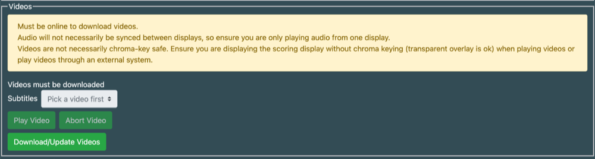

After the videos are downloaded, play them directly from FTC Live. They play
after a short delay on all connected audience displays, with subtitles
enabled.

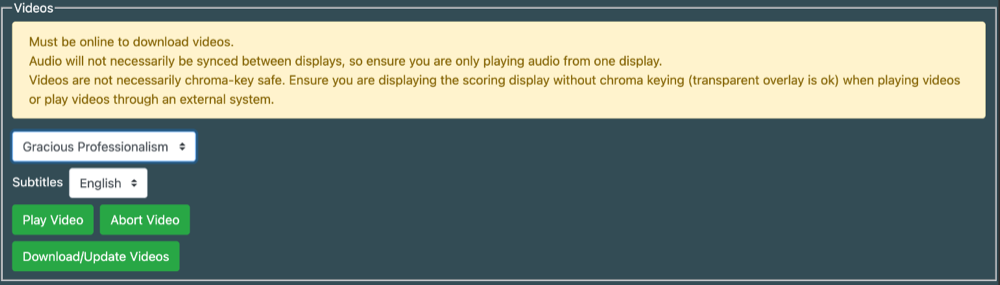

.. note::

   The videos are not perfectly synchronized between displays. Play audio from
   only one source for the best audience experience.

Confirm the Schedule
--------------------

The first step to a smooth event is to confirm the public event schedule with
the Event Director and the *FIRST* Technical Advisor (FTA).

- Verify that all the times on the schedule are correct, especially match play,
  breaks, judging, awards, and lunch. You need this information to create the
  match schedule.
- Make sure the schedule lists the correct number of teams and the correct
  team numbers.

FTC Live has three schedules, one for each kind of match. The playoff schedule
depends on the qualification schedule and alliance selection being complete.

- Practice match schedule. See :doc:`/ftc_live/event_operation/match_control/match-control`.
- Qualification match schedule. See :doc:`/ftc_live/event_operation/match_control/match-control`.
- Playoff schedule. See
  :doc:`/ftc_live/event_operation/alliance_selection_and_playoffs/alliance-selection-and-playoffs`.

Teams
-----

.. note::

   Do the main team setup in the cloud-based Event Portal, not in FTC Live, and
   then transfer the event data to FTC Live. The process is the same in both
   systems, but data stored in the cloud synchronizes with the FTC Events
   website. If teams arrive late or don't show up, you can add or edit them in
   FTC Live. FTC Live synchronizes those changes when it is online.

Check Team Participation
^^^^^^^^^^^^^^^^^^^^^^^^

The teams added before the data transfer are listed under the **Add/Edit
Teams** button on the FTC Live Event Dashboard. Use this page as a checklist of
team status, and verify that the teams that checked in are playing in matches,
judging, or both.

- Check that the teams listed for match play are the right ones.
- Remove teams that aren't participating.
- Change the team's status to "Judging Only" in its team profile, if needed.
- Add teams that aren't on the team list yet. This synchronizes back up to the
  cloud.
- Generate the match schedule after all teams have checked in or the check-in
  deadline has passed. Ask the Event Director about the status of teams that are
  running late before you remove them from the event.

Open the Team List
^^^^^^^^^^^^^^^^^^

#. From the event home page, go to the **Event Dashboard**.
#. Select the **Add/Edit Teams** button to open the Team List page.

The Team List page opens on the **Add Individually** tab. You can edit each
team profile from that tab: double-click the team's **Edit** button to open
the Team Profile page. Only this tab lets you edit a team's event status or
other detailed information.

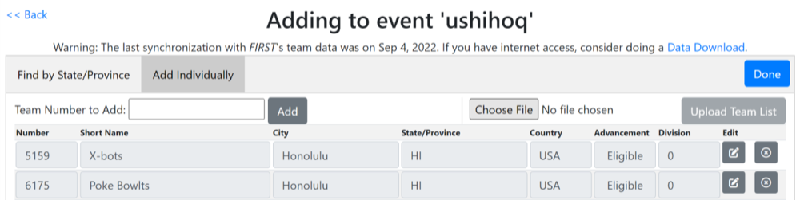

The cloud-based system comes with a prepopulated list of teams that are
registered and paid, and registered with Lead Coach 1 and 2. The **Data
Download** link updates this list.

Add Teams
^^^^^^^^^

The tabs at the top of the Add/Edit Teams page give several ways to add teams.
When you finish adding and editing teams, select **Done**.

Add Individually
   #. In the **Team Number to Add** field, type the number of the team to add.
   #. Select **Add** to the right of the field.

   .. image:: images/add-team-number.png
      :alt: The Add Individually tab with a team number typed in the Team Number to Add field and the Add button, both circled in red.

   If the system already has the team's data, the new team appears with its
   information. If it has no data for the team, fill in the remaining columns
   yourself.

By State or Province
   This is the easiest way to add many teams. Select the **Find by
   State/Province** tab. The system displays a list of prepopulated teams for
   the region you select.

   #. Use the **Country** and **State/Province** controls to choose where to
      look.

      .. image:: images/country-state-select.png
         :alt: The Find by State/Province tab with the Country menu set to Mexico and the State/Province menu set to CHH.

   #. Check the box beside each team to add it to the event. The row turns
      purple.

      .. image:: images/state-teams-selected.png
         :alt: A list of New Hampshire teams with checked boxes and purple highlighted rows.

   To add a single team, use the **Add Individually** tab instead.

By League, or by Uploading a List
   You can also add teams by league, or upload a team list file:

   - FTC Live can read team list files from past *FIRST* Tech Challenge
     seasons (before 2018-2019).
   - An Event Admin can also create a plain text file with one team number on
     each line and use it as a team list.

   #. Select **Choose File** and use the file browser to select your team list
      file.
   #. Select **Upload Team List**.

   .. image:: images/upload-team-list.png
      :alt: The Choose File and Upload Team List buttons, each circled in red, above a team list.

   The uploaded teams are added to the team list for the selected event.

Remove a Team
^^^^^^^^^^^^^

The default **Add Individually** page lists every team at the event. Scroll to
the team and select the **X** button at the far right of its row.

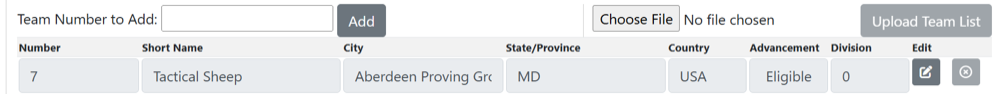

You can also select the delete button on the right side of a team's row in the
list (circled in the example below).

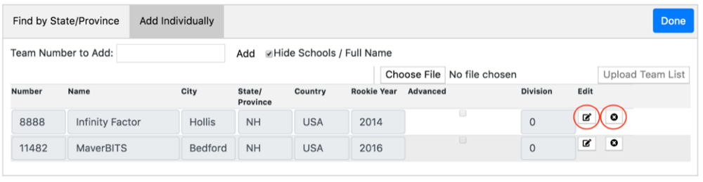

Change a Team's Competing Status
^^^^^^^^^^^^^^^^^^^^^^^^^^^^^^^^

.. important::

   You must do this for every team that isn't participating in matches.
   Otherwise FTC Live adds the team to the match schedule.

#. Double-click the team's **Edit** button on the right-hand side.
#. Scroll down to **Competing**. It defaults to "Matches and Judging." Select
   "Judging Only" or "Not Competing."

   .. image:: images/competing-status.png
      :alt: The Competing menu on the team profile, set to Matches and Judging.

Judging Only
   Removes the team from the match schedule.

Not Competing
   Lets a *FIRST* Leadership Award team appear in the Awards drop-down for a
   *FIRST* Leadership Award student.

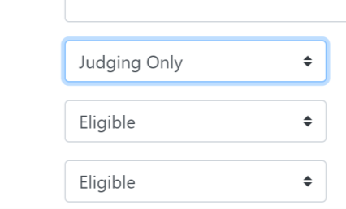

Check Team Eligibility
^^^^^^^^^^^^^^^^^^^^^^

The Event Director or the Program Delivery Partner (PDP) is responsible for
the override process. The *FIRST* Event Portal Region Management Guide has the
details on overriding a team's Advancement or Inspire 1 eligibility. Making
changes needs their approval. *FIRST* Headquarters monitors all overrides.

- Change a team's profile based on the Eligibility report.
- Override a team's eligibility for "Advancement" or "Inspire 1" if the team is
  "Ineligible."

If necessary, you can also make these overrides in FTC Live. Select
**Override**, then change the selection between "Ineligible" and "Eligible."
Talk to *FIRST* Program Support about eligibility overrides if you have any
concerns.

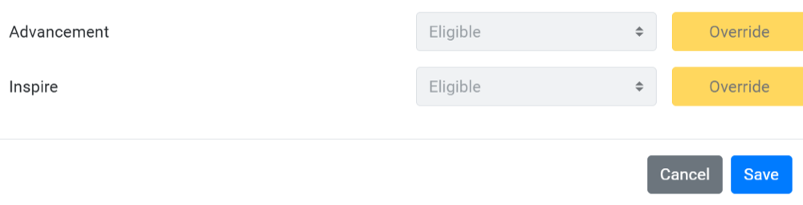

Warning Icons
^^^^^^^^^^^^^

Several icons appear beside a team on the Add/Edit Teams page when its data is
inconsistent. The icons don't affect your ability to run a traditional event in
FTC Live, but they may affect the match results shown on the FTC Events
website.

.. list-table::
   :header-rows: 1
   :widths: 30 70

   * - Icon
     - Meaning
   * - Blue circle with an exclamation mark
     - The team won't appear in the match schedule because it is marked
       "Judging Only" or "Not Competing."
   * - Red circular arrows
     - The team's data doesn't match the corresponding team in *FIRST*'s
       database. The team information shown with event results may look
       different.
   * - Orange triangle with an exclamation mark
     - The team isn't registered with *FIRST*.
   * - Black triangle with an exclamation mark
     - The team hasn't paid its *FIRST* registration fees. Contact the PDP and
       get approval before you add the team to the event.

Download Team Data Manually
^^^^^^^^^^^^^^^^^^^^^^^^^^^

You don't usually need this step, because FTC Live does a data download every
time the software launches. To run one yourself, go to **Manage Server** in the
**Event Admin** menu.

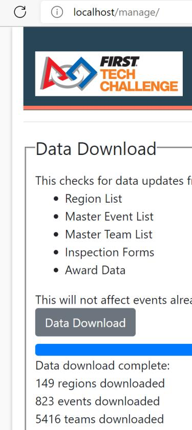

If the event is online, the Add/Edit Teams page also has a **Data Download**
link.

Print Documents
---------------

One of the most important jobs of the Scorekeeper or Field Supervisor is to
know what the volunteers need printed. For example, the Lead Queuer needs the
team list and the match schedule to make sure the right teams are ready for
their matches.

- Print the match schedule and the list of teams as soon as the team
  verification and edits are complete.
- The **Event Reports** menu has other optional printables.
- The **GA/Emcee** menu has the Announcer Report and the Alliance Selection
  printables.

The number of items to print depends on several factors. Talk to the FTA and
Event Director to decide what printables the event needs.

Print the Match Schedule
^^^^^^^^^^^^^^^^^^^^^^^^

Before the event starts, go to the event home page. Under **Event Info**, print
the **Schedule** and **Rankings** under **Qualifications** once the
qualification schedule is ready. After the playoffs are scheduled, print the
**Schedule** and **Rankings** under **Playoffs**.

Check the **Condensed** box before you print.

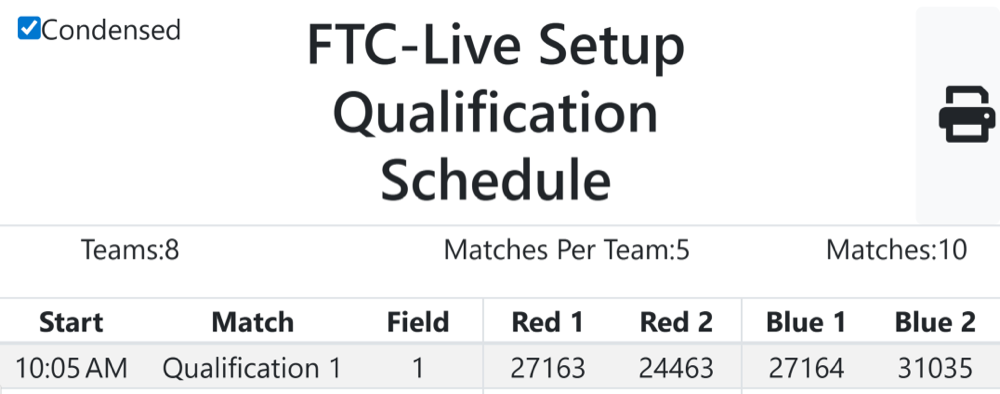

Print the List of Teams
^^^^^^^^^^^^^^^^^^^^^^^

An event needs a few copies of the team list. Give them to the Event Director
to hand out to the volunteers who need them.

The **Competing Teams** report is under **Event Info**, then **Event Reports**.
Check the boxes the event needs: **Condensed**, **Show Affiliation**, **Show
City**, **Show State**, **Show Country**, and **Show Rookie**. Make sure
**Condensed** is checked.

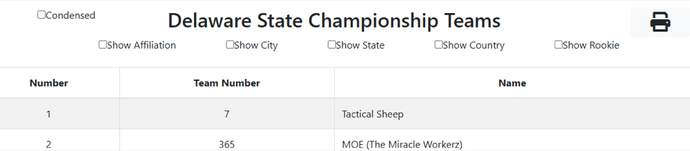

Accounts for Tablets
--------------------

Each volunteer who uses a tablet needs a user account to open the pages for
their task. These accounts give Official Scorers, Inspectors, and other users,
such as the FTA, access to specific tasks on a tablet.

.. _ftc live generate random accounts:

Generate Random Accounts
^^^^^^^^^^^^^^^^^^^^^^^^

#. On the Event Dashboard, select **Create Default Accounts**. The Default
   Accounts screen opens.

   .. image:: images/default-accounts.png
      :alt: The Default Accounts page with a Generate New Random Accounts button, a Reset Accounts button, and a print button.

#. Select **Generate New Random Accounts**. It may take a few seconds. FTC Live
   generates a set of accounts that give limited access to the system for the
   selected event. Each account has a username and password.
#. Print the list to PDF, or select the printer icon at the upper right of the
   screen to print a copy. Email the PDF or give a copy to the Event Director.
   Select a QR code to see a larger version.

FTC Live also generates QR codes. A user scans the QR code to set up their
tablet for scoring, inspections, and other functions. If the tablet has no QR
code reader software, open the IP address of the FTC Live server in the
tablet's browser and use the **Scan QR Code** feature on the login page.

After you generate the accounts, assign each one to a tablet. A good practice
is to put a label on the tablet, such as "Red Alliance Official Scorer."

Emcee/GA
   Tablet for the opening ceremony scripts.

Head Referee
   Tablet to keep track of Head Referee data throughout the event.

Official Scorer
   Tracks one alliance color per tablet.

FTA
   Tablet to keep notes about teams throughout the event.

Inspector
   Tablets that inspectors use for the electronic inspection status.

Manage and Add Users
^^^^^^^^^^^^^^^^^^^^

An event administrator can change the password and access permissions of a
user account. Select **Manage Users** in the **Event Admin** menu, then use the
screen to review and change the information for the account.

The Scorekeeper can add new users by selecting **Create User** in the **Event
Admin** menu. Choose the **All Events** option, or choose an individual event
for the user. One user can have more than one role.

When logged in, a user can change their own password by selecting the
**Hello** link at the upper right. An event administrator can reset all the
accounts to their original passwords with the **Reset Accounts** button.

Inspection
----------

FTC Live has a built-in inspection status and scheduling tool. Use it to track
the inspection process at an event that uses tablets. Inspectors log in with
the user IDs and passwords from
:ref:`ftc live generate random accounts`.

The inspection displays show inspection status from the **Video Switch** tab in
Match Control **Settings**. Before you use them, make sure the team list is
final, and that the inspection settings are set up under **Inspection Status
and Schedule**. For setup instructions, see
:doc:`/ftc_live/features/inspection_tools/inspection-tools`.

Sponsors
--------

FTC Live comes with the *FIRST* Tech Challenge season presenting sponsor
already loaded. That sponsor can't be changed, and every event must display it.
You can also add regional or event sponsors.

Add or Edit Sponsors
^^^^^^^^^^^^^^^^^^^^

Select **Add/Edit Sponsors** to create or edit the sponsor list for your event.

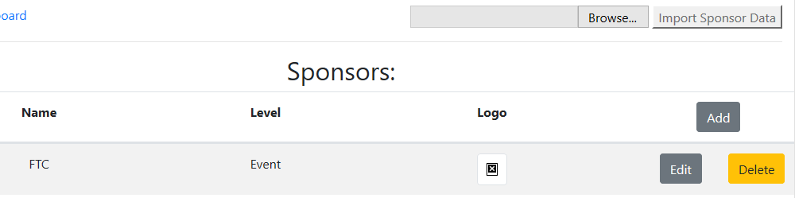

#. Select **Add** to add a sponsor to the event.
#. Enter the sponsor's name.
#. Select the sponsor type: Global, Regional, or Event.
#. Select **Create Sponsor**.
#. To add a logo, use **Choose File** and **Import Logo**.

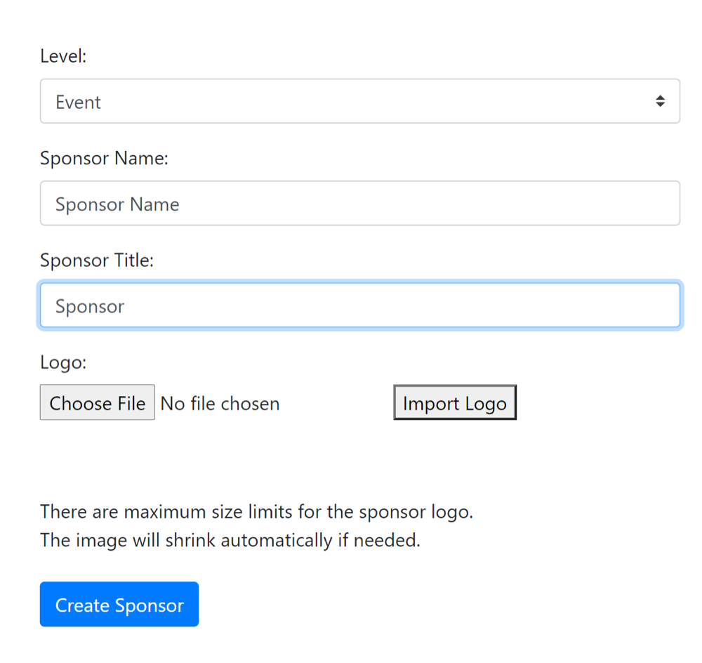

.. tip::

   PNG logo files work well with FTC Live. Always ask the sponsor for its
   official logo. The sponsor logo has a maximum size, and FTC Live shrinks it
   automatically if needed.

Display a Sponsor
^^^^^^^^^^^^^^^^^

Show sponsor information on the audience displays from the **Video Switch** tab
of the Match Control page. See :doc:`/ftc_live/event_operation/match_control/match-control` for
details.
