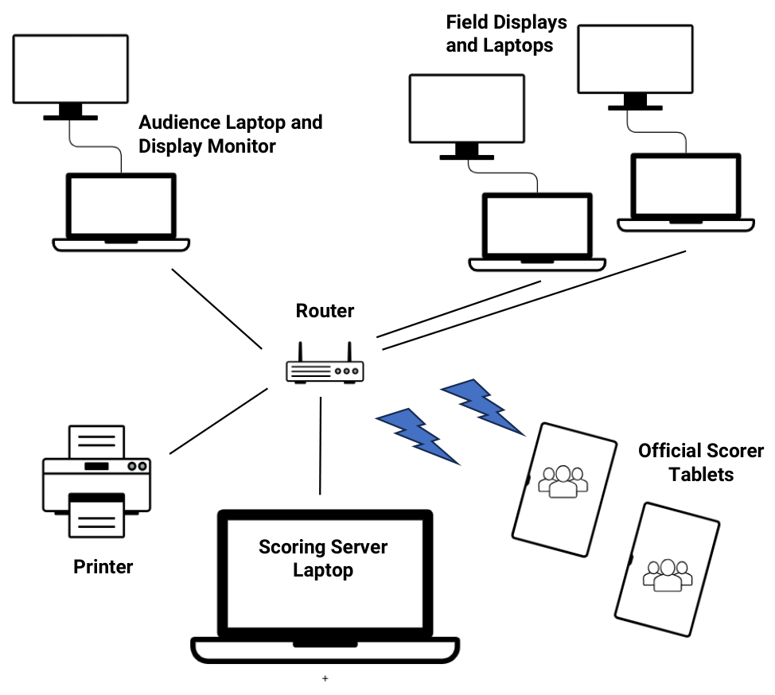

Hardware and Network Requirements
=================================

For most events, the hardware needed to run FTC Live is modest. The network is
often more important to a successful event than the server hardware.

Displays
--------

A 27" monitor is the recommended minimum for audience and field displays. Pit
displays may need a larger screen because the pit area is busy.

Most events connect a laptop to a monitor for each of these displays:

#. **Field displays** show real-time match data for each field.
#. **Audience display** shows a large timer that field staff and teams can see
   in the arena.
#. **Pit display** shows rankings and the optional inspection schedule and
   tracking in the team pit area.

Tablets
-------

Events use tablets for several purposes, including:

- Official Scorers entering match details (one per alliance).
- Inspectors performing electronic inspection.
- Field Technical Advisors (FTAs) using the FTA Notepad.
- Game Announcers and Emcees viewing award scripts and match information.

Android and iOS tablets both work with FTC Live. The tablet layouts are
designed for a tablet with a 7" or larger screen. Charge all tablets fully
before the event starts.

Computer and Tablet Requirements
--------------------------------

FTC Live runs on Windows, Mac, and other platforms. It is a browser-based
application, so you use it only through a web browser. It supports real-time
score tracking, schedules, printable reports, inspection tracking, Head
Referee and FTA notes, and awards.

.. note::

   A large event, such as a dual division event, may need a higher performing
   computer than the minimums below.

Scoring Server (Windows, Mac, or Linux)
^^^^^^^^^^^^^^^^^^^^^^^^^^^^^^^^^^^^^^^

Hardware
   - Intel Core i5 processor
   - 4 GB of RAM
   - 300 MB of available disk space
   - CAT 5 Ethernet adapter (a USB adapter is fine if the computer has no
     built-in port)
   - 802.11 Wi-Fi adapter

Windows
   - Windows 7, 10, or 11
   - Google Chrome version 80 or higher. Firefox is not supported.
   - Wi-Fi support to connect to a wireless network
   - An Ethernet adapter to connect to a wired network

Mac
   - macOS Sierra or newer
   - Google Chrome version 80 or higher
   - Wi-Fi support to connect to a wireless network
   - An Ethernet adapter to connect to a wired network

Tablets
^^^^^^^

Android
   - Android Marshmallow (6.x) or newer
   - Wi-Fi support
   - Google Chrome version 80 or higher

iOS
   - iOS 15 or newer
   - Google Chrome
   - Wi-Fi support

Network Requirements
--------------------

- Use a dedicated local network for your scoring devices, not one shared with
  other users or applications. This is typically a consumer-grade wireless
  router.
- Keep the scoring server local to your event. Don't run it through a remote
  Internet or cloud connection, which causes latency problems.
- Put the scoring network on its own secure network that is not open to the
  public. This lowers the risk of malicious activity against FTC Live.
- Use a wired (Ethernet) connection whenever possible. The real-time Official
  Scorer tablets are wireless.
- Ask the FTA, or the Technical Director if the event has one, to confirm that
  the Wi-Fi Event Planning Guide has been followed. Review the Venue
  Networking Requirements Guide with the venue's IT staff.

For more about Wi-Fi channels and interference with robots, see
:doc:`/control_system_troubleshooting/wifi_channel_planning/wifi-channel-planning`.

System Layout
-------------

FTC Live works in many configurations. FIRST Tech Challenge technical support
supports the most commonly used layout, described here, and a basic layout
for paper scoring, an emergency backup described in
:doc:`/ftc_live/features/paper_scoring/paper-scoring`.

Most Used Configuration: Real-Time Scoring
^^^^^^^^^^^^^^^^^^^^^^^^^^^^^^^^^^^^^^^^^^

This configuration uses a pair of wireless tablets, one per alliance, so
Official Scorers can track scores in real time.

   Configuration for real-time score tracking using tablets and display
   monitors.

The configuration has these components:

Scoring server laptop
   Has the FTC Live software installed and acts as the server for the whole
   system. It is also used for match control and scorekeeping, such as
   reviewing, editing, and committing scores.

Printer
   Prints match, judging, and inspection schedules, reports, and other
   documents.

Network router with Wi-Fi
   Connects the system components together.

   .. note::

      Follow the router's instructions to set up the network. If the router
      runs a DHCP server, check that its IP subnet doesn't overlap with the
      subnet used for internet access.

Field display laptop
   A laptop that uses a web browser and a network connection, wired or
   wireless, to reach the server and show field information during the
   event. Connect it to a large monitor.

Audience display laptop
   A laptop that uses a web browser and a network connection to reach the
   server and show information for spectators. Connect each display laptop to
   a large monitor, with at least one per division.

Official Scorer tablets
   Use at least two per field, one per alliance. They connect wirelessly and
   use a web browser to reach the scoring server at its IP address. Official
   Scorers track the score in real time during a match. After the match they
   review, edit, and submit their scores.

You can add more tablets for real-time inspections, Head Referee notes, FTA
notes, and similar uses.

Tips for the System Layout
^^^^^^^^^^^^^^^^^^^^^^^^^^

- Know the IP address of the computer running FTC Live (the Scorekeeper laptop
  in this example). To use the system from an Official Scorer tablet or display
  computer, enter that IP address in the device's web browser. The server IP
  appears in the header bar of every FTC Live page. If the displayed IP
  doesn't work, ask the *FIRST* Technical Advisor or the venue's IT
  administrator for the server's address.
- Run FTC Live's wireless traffic on a 5 GHz Wi-Fi channel so it doesn't
  interfere with robot control.
- Audio cues for a public address (PA) system, such as the match start and stop
  sounds, come from browser tabs running an Audience or Field Display. A
  display must be open on the device to make sounds. Use one computer as the
  only source of PA audio so the sounds stay in sync.

System Best Practices
^^^^^^^^^^^^^^^^^^^^^

- Use a dedicated, standalone router, and follow the best practices in the
  FTC Live Network Setup Guide.
- Disable all firewalls on the computer running the server.
- Put all displays and tablets on the router's local LAN.
- Use a 5 GHz Wi-Fi channel if the router supports it.
- If the Scorekeeper needs internet access, bridge it through a second network
  adapter, such as a USB Wi-Fi dongle. Make sure the scoring server picks up
  the IP address of the right adapter.

Configurations Not Supported by FTC Technical Support
-----------------------------------------------------

Technical support doesn't troubleshoot these configurations, because they have
too many variables or need a local point of contact to fix the network.

School Networks
^^^^^^^^^^^^^^^

.. warning::

   *FIRST* cannot provide day-of-event network or setup support for setups that
   use a school network.

School networks may not work. They often:

- Have aggressive internal firewalls.
- Block all traffic from unknown devices.
- Block devices from talking to one another.

Organizers must work with school IT staff to set up and test the network
before event day. Setting up on the day of the event in an unfamiliar school
very often fails.

Cellular Hotspots
^^^^^^^^^^^^^^^^^

When there is no constant internet connection, events often use cellular
hotspots to push scoring data to the FTC Events website periodically. Service
providers control hotspots, and they don't all allow every protocol and
communication between devices, even on the same network. Many mobile operating
systems block devices on a cellular connection from communicating with each
other.

*FIRST* has no recommendations for cellular hotspots and not enough data to
make any. If your setup uses a hotspot, test it thoroughly before the event.
