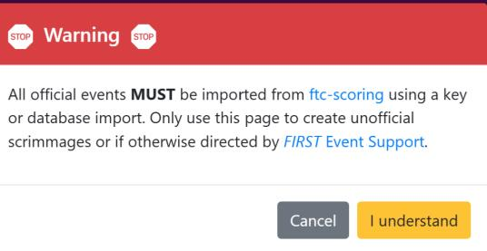
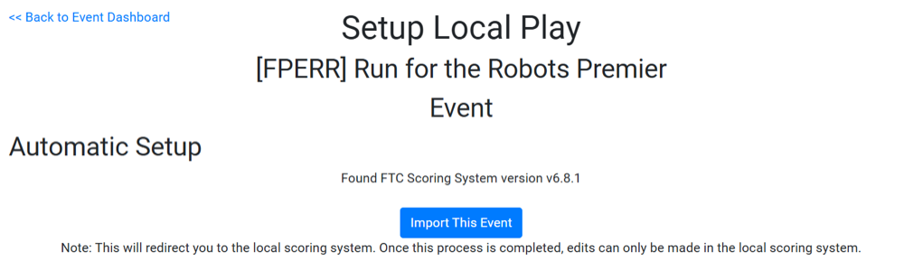

Transfer Event Data
===================

Event data is set up in the Event Portal, then transferred to FTC Live. After
the transfer, FTC Live holds the official event data and is the source of
truth for the event results. Any change after the transfer must be made in FTC
Live.

Make sure FTC Live is running on the event laptop when you transfer the data.

When to Transfer
----------------

Transfer the event data no more than two days before the event starts. The
best time is the day or evening before. FTC Live locks in many variables at
the time of transfer, and software updates may not be applied to them. A
transfer that happens too early can cause a problem that is hard to recover
from.

.. warning::

   If the event data was transferred to FTC Live more than two days before the
   event, contact *FIRST* HQ right away. They can help you decide how to avoid
   invalidating your event.

Who Can Transfer
----------------

The people who can transfer an event use the *Play Locally* button in the
Event Portal. They get the role through VMS or LMS training, or by being added
to the event in the Event Portal:

- Event Portal Region Administrator, who also enters event data in the Event
  Portal before the event.
- Event Portal Region Manager
- *FIRST* Technical Advisor
- Scorekeeper, who works with the Event Director on changes to data in FTC Live
  after the transfer.
- Technical Director, who works with the Event Director on changes to data in
  FTC Live after the transfer.
- Event Portal League Administrator

Choose a Transfer Method
------------------------

The transfer methods depend on whether you have internet access and access to
the Event Portal at setup time.

.. list-table::
   :header-rows: 1

   * - Internet access
     - Event Portal access
     - Recommended method
   * - Yes
     - Yes
     - Automatic import
   * - Yes
     - No
     - Manual setup with an event key
   * - No
     - No
     - Offline setup

.. important::

   Official events must use the automatic or event key method. Contact *FIRST*
   HQ support if you need to do an offline setup for an official event.

Before you transfer the data in the Event Portal:

#. Go to the correct event dashboard.
#. Confirm that the teams, event configuration, advancement (if it applies),
   and other data are correct.
#. Scroll down to the **Play Locally** button, or go straight to
   ``https://event-portal.firstinspires.org/ftc/<year>/<event code>/dashboard/local/``
   with your event code.

The transfer page opens with the three options.

Automatic
^^^^^^^^^

This is the ideal method. You need an internet connection, the FTC Live
software, and access to the Event Portal.

#. Launch FTC Live using the app.
#. Log in to the Event Portal with your *FIRST* dashboard email.
#. Go to the event dashboard and select **Play Locally**.
#. If the page says it found the FTC Scoring System and shows a version number,
   select **Import This Event**. The event opens in FTC Live in a new browser
   window.

Manual Setup with an Event Key
^^^^^^^^^^^^^^^^^^^^^^^^^^^^^^

The event laptop needs internet access for this method.

#. In the Event Portal, copy the event key. You can email it to the Event
   Director for record keeping. The Scorekeeper or Technical Director can also
   log in and do this step.
#. In FTC Live, log in with the username ``local`` and no password.
#. Select **Event Admin** at the top left, then **Setup Event**.
#. Select **Manual Setup**.
#. Enter the event key.

.. caution::

   Give the event key only to the people running the scoring system at this
   event. Don't share it more widely.

Offline Setup
^^^^^^^^^^^^^

Download the event database file from the Event Portal, then upload it to FTC
Live.

#. In FTC Live, log in with the username ``local`` and no password.
#. Select **Event Admin** at the top left, then **Setup Event**.
#. Select **Offline Setup** and upload the file.
#. Review the event name, date, and location, then confirm.

Leagues
-------

The Event Portal calculates league rankings from the published match results
of a previous event, and includes them in the transfer. Make sure earlier
events for the league are published before you transfer the event data.

Back-to-Back Events
-------------------

You can run events on the same day or the same weekend, but they need special
care. Email ftctech@firstinspires.org in advance if you plan back-to-back
events and need help uploading the first event before you download the second
event's data, or if a team attending both events has an advancement problem.
Asking ahead lets on-call staff prepare, because these events can have data
transfer and advancement problems.

Examples of the problems:

- One or more teams are in two events, and the first event's results aren't
  fully uploaded before the second event's database is downloaded to FTC Live.
- An event depends on the advancement results of another event that hasn't
  fully uploaded.
- An event that depends on an earlier one runs offline and doesn't use the
  earlier event's results. This can happen in closely scheduled league meets,
  but is otherwise rare.

Set Up an Unlisted Event
------------------------

Use an unlisted event to test FTC Live or to run matches that won't appear on
the FTC Events website. This workflow doesn't sync with the Event Portal.

#. Log in to FTC Live as ``local`` with no password.
#. Open the **Event Admin** menu and select **Setup Event**.
#. Select **Offline Setup** and ignore the note.
#. On the next screen, select **Manual Setup**.
#. Fill in the required fields, which are highlighted in red: Event Code,
   Region, and the event start and end dates. Select **Create Event**.

   .. image:: images/unlisted-event-form.png
      :alt: The unlisted event form with the Event Code, Region, Event Start Date, and Event End Date fields highlighted as required.

#. Select **Back to Event Home** to start using FTC Live.

.. note::

   You can't use **Create Match Schedule** on the Event Dashboard until you
   add teams to the event.
