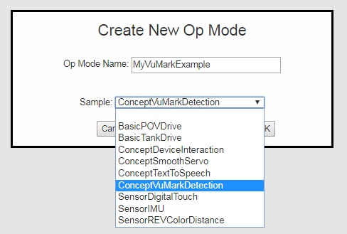

Blocks Reference Materials :bdg-warning:`Blocks`
================================================

Blocks Reference Manual
~~~~~~~~~~~~~~~~~~~~~~~

As you start to write more complicated :term:`OpModes <OpMode>`, you will need to use
more features of the FIRST Tech Challenge :term:`software development kit <Software Development Kit>`
(SDK). Bruce Schafer of the Oregon Robotics :term:`Tournament` & Outreach
Program (ORTOP) created a useful reference document that describes the
programming blocks that are available with the
:term:`Blocks Programming Tool`:

`Blocks Programming Tool Reference
Manual <https://www.ortop.org/ftc/BlocksProgramming/BlocksProgrammingReferenceManual.pdf>`__

Sample OpModes
~~~~~~~~~~~~~~~

The Blocks Programming Tool has several built-in example OpModes that
demonstrate how to do different tasks with the FIRST Tech Challenge
:term:`control system <Control System>`. As you create a new file, you can use the Sample
dropdown list control to display a list of available sample OpModes or
templates:

|

Technology Forum
~~~~~~~~~~~~~~~~

Registered teams can create user accounts on the FIRST Tech Challenge
Community forum. Teams can use the forum to ask questions and receive 
support from the FIRST Tech Challenge community.

The technology forum can be found at the following address:

- https://ftc-community.firstinspires.org

REV Robotics Control Hub Documentation
~~~~~~~~~~~~~~~~~~~~~~~~~~~~~~~~~~~~~~

`REV Robotics Control Hub Getting Started
Guide <https://docs.revrobotics.com/duo-control/control-hub-gs>`__

REV Robotics Expansion Hub Documentation
~~~~~~~~~~~~~~~~~~~~~~~~~~~~~~~~~~~~~~~~

`REV Robotics Expansion Hub Getting Started
Guide <https://docs.revrobotics.com/duo-control/control-system-overview/expansion-hub-basics>`__

REV Robotics Driver Hub Documentation
~~~~~~~~~~~~~~~~~~~~~~~~~~~~~~~~~~~~~

`REV Robotics Driver Hub Getting Started
Guide <https://docs.revrobotics.com/duo-control/driver-hub-gs>`__
