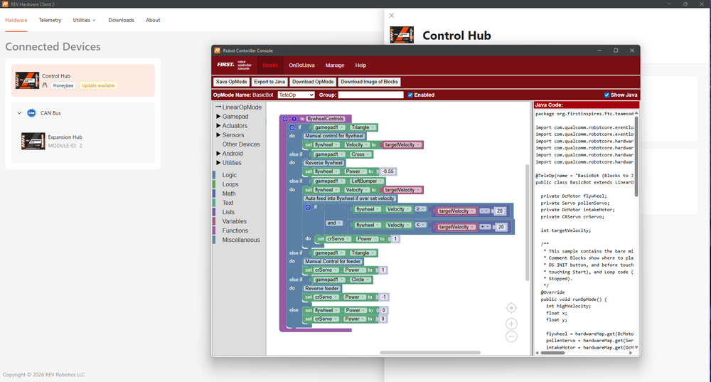

Meet the REV Hardware Client 2
==============================

Started in the 2023-2024 season, Tech Tips are segments released in the
*FIRST* Tech Challenge `Team E-mail Blast
<https://www.firstinspires.org/resources/library/ftc/team-email-blast-archive>`__.
Sometimes the Tech Tips are included in whole in the email blast, but sometimes
there is more content than is reasonable in the email blast so partial content
is included in the blast with the rest of the content here.

.. _revhardwareclient2:

A Fresh Start for the REV Hardware Client
-----------------------------------------

The :term:`REV Hardware Client` (RHC) is the desktop app most teams use to keep
their Control Hub, Expansion Hub, and Driver Hub software up to date. Its
successor, the **REV Hardware Client 2** (RHC 2), is not just a new version
number - REV rebuilt it from the ground up as a completely separate
application. That has a few benefits worth knowing about:

* **It runs on Windows, macOS, and Linux.** The original RHC was a
  Windows-only app. RHC 2 is available for Windows 10 and 11, recent versions
  of macOS, and recent Ubuntu and Debian Linux releases, so teams are no longer
  tied to a Windows laptop to maintain their robot. This is great for teams who
  might be tied to Mac or Linux-based school machines.
* **It installs alongside the original, not on top of it.** There is no
  automatic upgrade path from the original RHC to RHC 2. You install RHC 2 on
  its own, and REV recommends not running both apps at the same time. 
* **It covers more than one program's hardware.** RHC 2 manages devices for
  both *FIRST* Tech Challenge and *FIRST* Robotics Competition, so its
  Downloads list includes files you can safely ignore. It even handles some 
  hardware for the future control system, such as the A301 motors.

For step-by-step installation instructions and how to pre-download the files
your devices need, see
:doc:`Installing and Updating the REV Hardware Client </ftc_sdk/updating/hardware_client/Updating-REV-Hardware-Client>`.

.. warning::
   If your team uses an Android phone as a :term:`Robot Controller`, keep the
   original REV Hardware Client installed. RHC 2 cannot install or update the
   :term:`Robot Controller App` on an Android phone. See
   :ref:`Installing the RHC 2 <ftc_sdk/updating/hardware_client/Updating-REV-Hardware-Client:Installing the RHC 2>`
   for details.

What's New in RHC 2
-------------------

Beyond running on more operating systems, RHC 2 maintains features that most
users know and love, reworks a number of existing features, and adds some we 
didn't know we needed. Some highlights for *FIRST* Tech Challenge teams:

* **Automatic device detection** - plug a supported device in over USB and RHC
  2 finds it, with no need to hunt through menus.
* **One-click updates** - update all of the software on a connected device in
  a single step, or open the update manager to update several devices of the
  same type.
* **Offline-friendly downloads** - pre-download the latest firmware, operating
  system, and app files while you have internet access, then install them
  later at a competition where you don't.
* **Backup and restore** - back up user data from supported devices and
  restore it later.
* **Wireless Control Hub connections** - connect to a Control Hub over its
  Wi-Fi network, in addition to USB.
* **FTC Log Viewer** - view and stream the Robot Controller's log as your
  robot runs (see the next section).
* **Self-updating** - RHC 2 checks for new versions of itself, and shows you
  what changed after an update.
* **USB and Wi-Fi Programming** - RHC 2 maintains an active session window 
  for the Control Hub. If a Wi-Fi session drops it doesn't immediately kill
  the programming environment, when Wi-Fi is restored the session window
  reconnects and continues just like a web browser. This helps prevent lost 
  data while programming Blocks and OnBot Java through the RHC 2.
* **Dark mode** - for the late-night build sessions.

The full list of features, supported devices, and system requirements is on
REV Robotics' `REV Hardware Client 2 documentation
<https://docs.revrobotics.com/rev-hardware-client-2>`__, and the
`REV Hardware Client 2 changelog
<https://docs.revrobotics.com/rev-hardware-client-2/rhc2/overview/changelog>`__
tracks what's been added in each release.

   New active session programming portal in RHC 2.

Using RHC 2 to update individual devices is covered on these FTC Docs pages:

* :doc:`Updating the Robot Controller App </ftc_sdk/updating/rc_app/Updating-the-RC-App>`
* :doc:`Updating the Driver Station App </ftc_sdk/updating/ds_app/Updating-the-DS-App>`
* :doc:`Updating the Control Hub Operating System </ftc_sdk/updating/controlhub_os/Updating-the-Control-Hub-OS>`
* :doc:`Updating the Driver Hub Operating System </ftc_sdk/updating/driverhub_os/Updating-the-Driver-Hub-OS>`
* :doc:`Updating Hub Firmware </ftc_sdk/updating/hub_firmware/Updating-Hub-Firmware>`

NEW: Live Log Streaming
-----------------------

When something goes wrong on a robot, the Robot Controller's log file is
usually the best place to find out why - but digging it out of the Control Hub
after the fact takes time. The FTC Log Viewer in RHC 2 streams the log live
while your robot runs, so you can watch messages appear as you start an
:term:`OpMode`, press buttons, or reproduce a problem.

.. only:: html

   .. image:: images/live-logs-robot.gif
      :alt: A laptop running REV Hardware Client 2 scrolls live log entries while a robot beside it runs.

.. only:: latex

   .. image:: images/live-logs-robot.png
      :alt: A laptop running REV Hardware Client 2 shows live log entries next to a robot.

For tips on what to look for once you have the log in front of you, see
:doc:`Using Log Files </control_system_troubleshooting/using_log_files/using-log-files>`.

****

Got any questions about the REV Hardware Client 2? Come start or join the
conversation on the `FTC Community Forums
<https://ftc-community.firstinspires.org/>`__!
