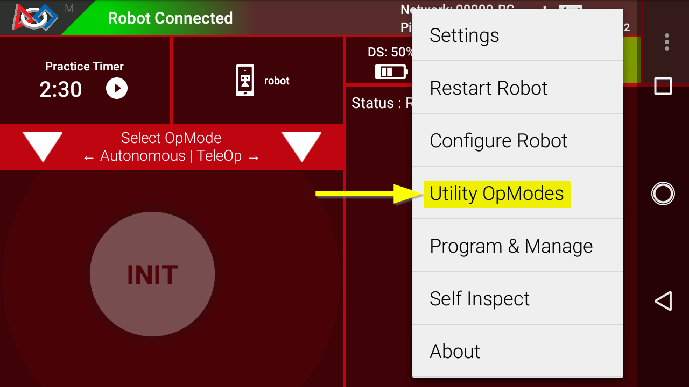
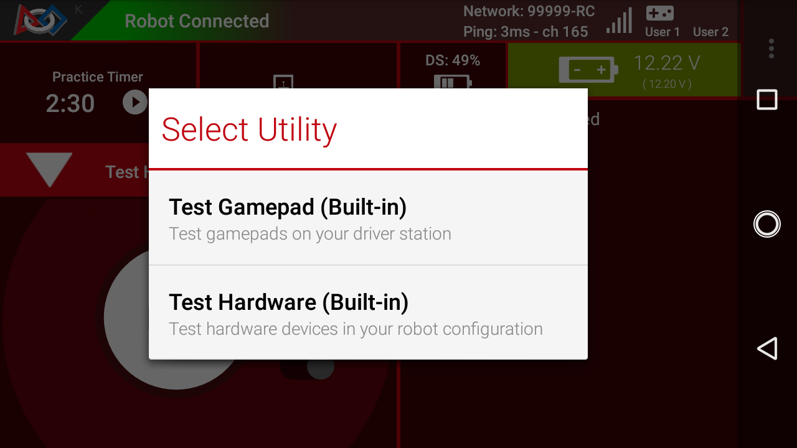

Utility OpModes
===============

Starting with version 11.2 of the *FIRST* Tech Challenge :term:`SDK <SDK>`,
Utility :term:`OpModes <OpMode>` are available to help test and troubleshoot
your robot. Utility OpModes can be run from the :term:`Driver Station App`.
Teams can also create their own Utility OpModes by using the ``@Utility``
annotation in Java, or by selecting Utility as the OpMode type in Blocks. 
This category of OpMode is for OpModes that are not meant for competition,
and thus shouldn't clutter the AUTO or TELEOP menus, but instead are 
OpModes that your team would use for maintenance or "utility" needs.

These OpModes reside in the Settings menu, and are accessed by selecting 
"Utility OpModes" in the menu. There are two built-in Utility OpModes:

* Test Hardware - Test the hardware in your configuration.
* Test Gamepad - Test your gamepad to ensure all buttons, triggers, and
  stick axes work properly.

   Figure 1: Accessing the Utility OpModes via the Settings Menu

   Figure 2: Accessing the list of Utility OpModes

.. toctree::
   :maxdepth: 1

   test_hardware/test_hardware_utility
   test_gamepad/test_gamepad_utility